# Daft.ie: place an ad (rental)

Captured November 2026. Desktop, signed in. For a landlord or agent listing a home to rent. Covers the whole flow up to payment: the ad type, all nine tabs and the ID check. Payment and publishing weren't captured.

The flow has nine tabs: Location, Price, Property details, Facilities, Description, Media, Plan, Contact, Review.

## Across every step

- The same frame each time: Daft's site header, the row of nine tabs with the current one underlined in blue, one narrow centred column (wider on Plan and Review), then the full site footer.
- A banner at the top of every step: "Rental listings may be subject to additional ID verification and monitoring to help protect renters and advertisers."
- On every tab but Review: a dismissible notice above the buttons ("We save your information every time you click Save & Continue so you can find it later in your draft ads"), then "BACK" (outline) and "SAVE & CONTINUE" (filled), both all caps.
- Optional fields say "(Optional)"; required fields aren't marked.
- No help text on fields, beyond placeholders and the odd info box.

## 1. Choose your ad type

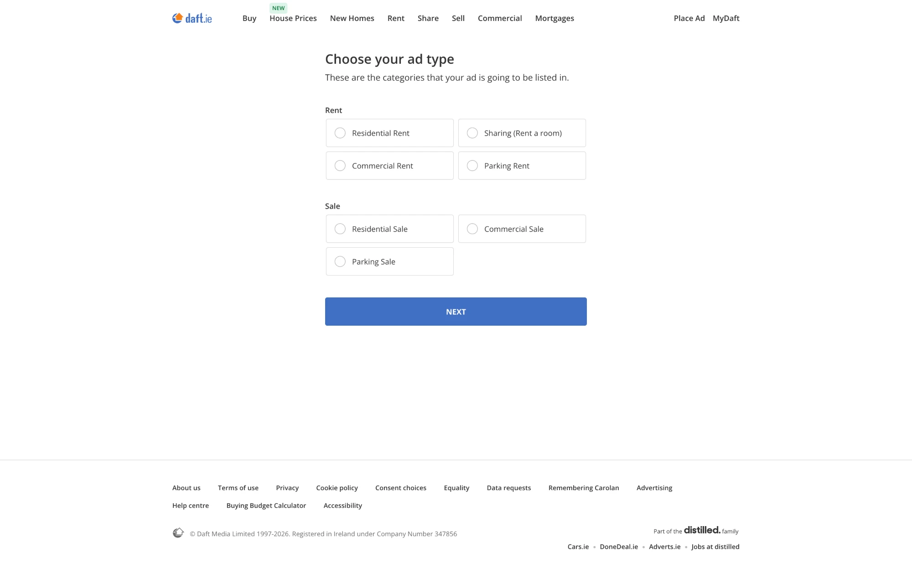

- "Choose your ad type. These are the categories that your ad is going to be listed in."
- Radio cards in two groups. Rent: Residential Rent, Sharing (Rent a room), Commercial Rent, Parking Rent. Sale: Residential Sale, Commercial Sale, Parking Sale.
- One full-width "NEXT" button, all caps.
- Comes before the tabbed steps, so it isn't shown as a step.

## 2. Location

### Empty

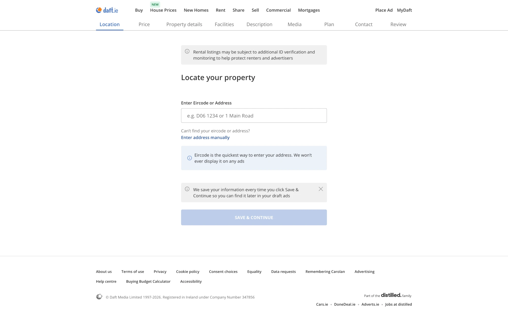

- "Locate your property": one field, "Enter Eircode or Address", with the placeholder "e.g. D06 1234 or 1 Main Road".
- "Can't find your eircode or address? Enter address manually" link.
- Info box: "Eircode is the quickest way to enter your address. We won't ever display it on any ads".
- "SAVE & CONTINUE" is disabled (pale) until an address is found.

### Address found

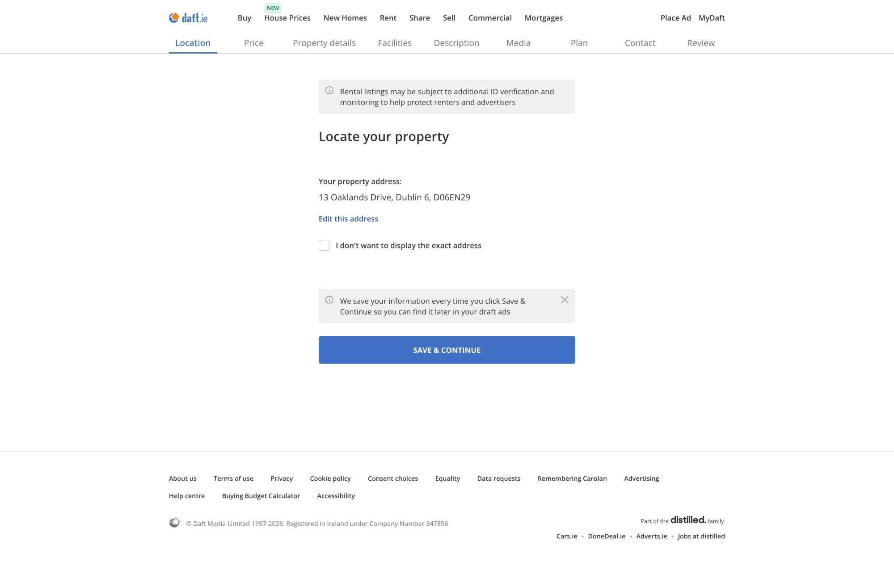

- The field is replaced by "Your property address:" with the full address and Eircode, and an "Edit this address" link.
- Checkbox: "I don't want to display the exact address".
- "SAVE & CONTINUE" is enabled.

## 3. Price

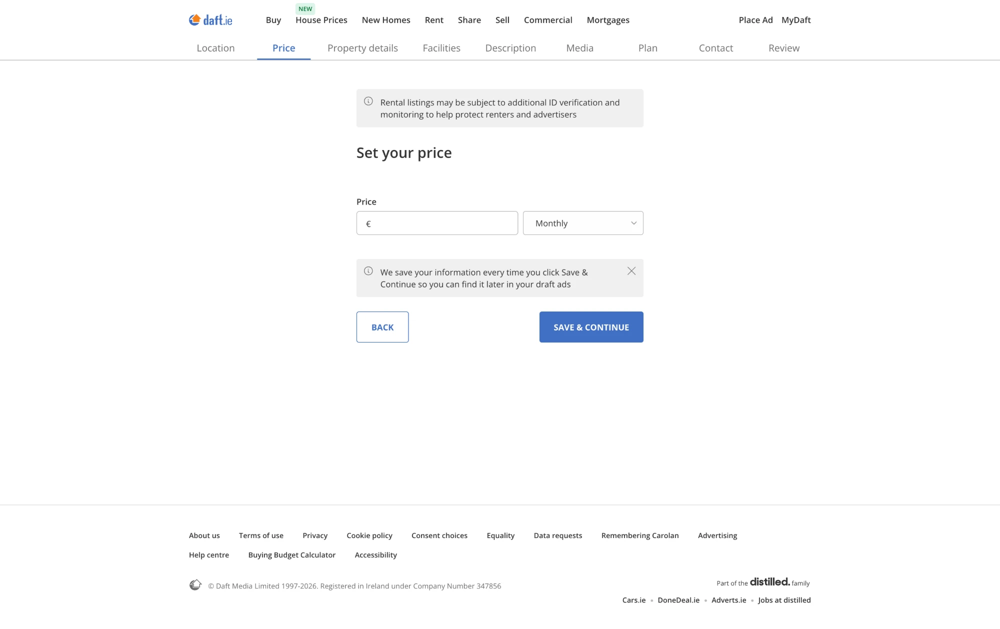

- "Set your price": a "€" field and a frequency dropdown, defaulting to "Monthly".
- No hint at the going rent, rent pressure zone rules or the last rent registered with the RTB.

## 4. Property details

### Empty

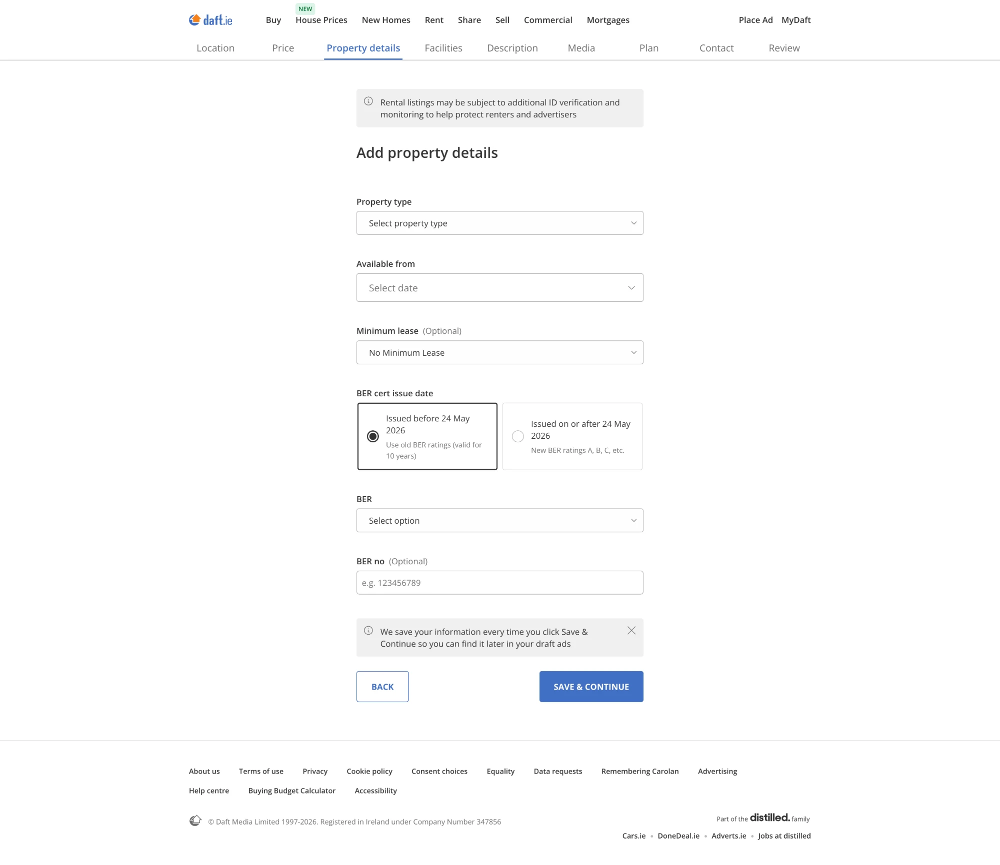

- "Add property details": Property type, Available from, Minimum lease (Optional), BER cert issue date, BER, BER no (Optional).
- "Available from" is a date picker ("Select date"). Its field is taller, with larger text, than the others on the page.
- "Minimum lease" defaults to "No Minimum Lease".
- "BER cert issue date" is a pair of radio cards: "Issued before 24 May 2026. Use old BER ratings (valid for 10 years)", selected by default, and "Issued on or after 24 May 2026. New BER ratings A, B, C, etc."
- "BER" is a dropdown with no "(Optional)", so it reads as required. "BER no" is optional, placeholder "e.g. 123456789", with nothing on where to find it.

### Filled in

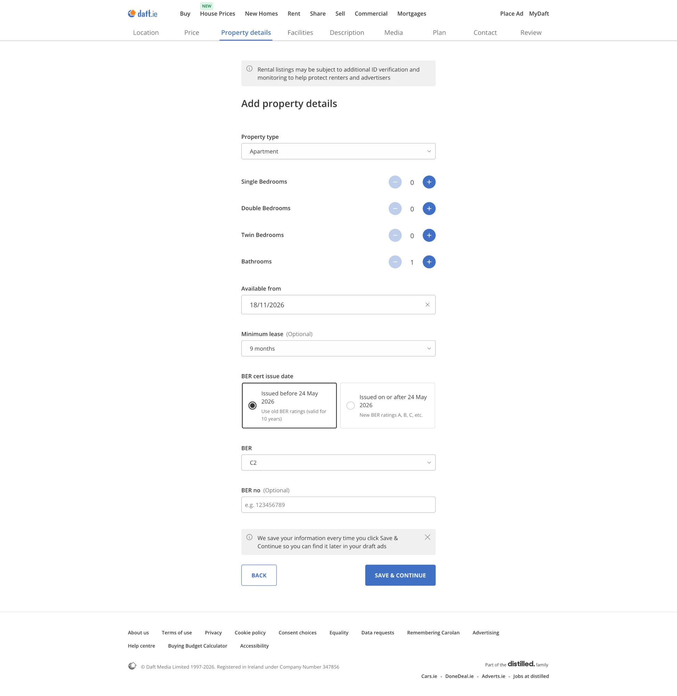

- Choosing a property type ("Apartment") reveals four counters: Single Bedrooms, Double Bedrooms and Twin Bedrooms (each starting at 0), and Bathrooms (starting at 1).
- Counters use round − and + buttons. The − is pale at the lowest value.
- Bedrooms are counted by kind, not as one number. Nothing on this step says how many people the home suits.
- "Available from" shows "18/11/2026" with a clear (×) button.
- Minimum lease set to "9 months" (the other options weren't captured).
- BER set to "C2" on the old scale.

## 5. Facilities

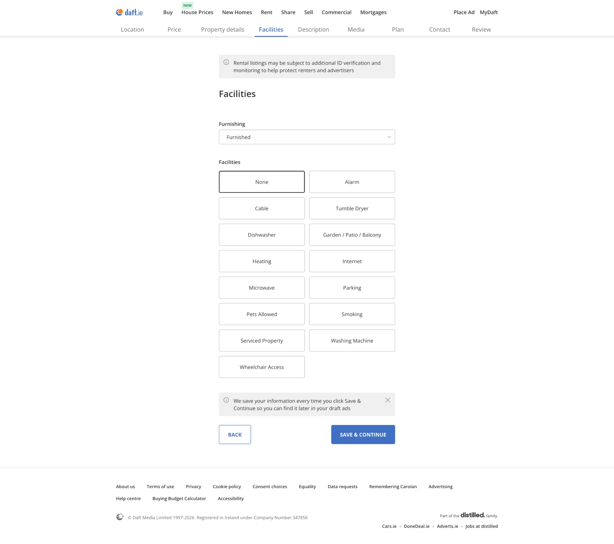

- "Furnishing" dropdown, showing "Furnished".
- "Facilities" is a two-column grid of 15 toggle tiles: None, Alarm, Cable, Tumble Dryer, Dishwasher, Garden / Patio / Balcony, Heating, Internet, Microwave, Parking, Pets Allowed, Smoking, Serviced Property, Washing Machine, Wheelchair Access.
- "None" has a heavier border, which looks like the selected state. There's no tick or other marker: the border is the only sign.
- Appliances, outdoor space, house rules (pets, smoking) and access are mixed in one list, with no grouping.
- Every tile is yes or no. Pets: no kind or number, and nothing on assistance dogs. Heating, Internet and Parking: no type, speed or number of spaces.

## 6. Description

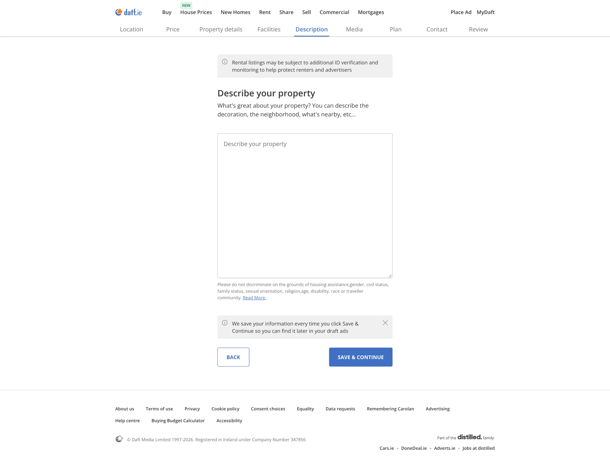

- "Describe your property. What's great about your property? You can describe the decoration, the neighborhood, what's nearby, etc..." (US spelling).
- One large, resizable free-text box, placeholder "Describe your property". No character count, no prompts or structure, and no help writing it.
- Under the box, in small grey text: "Please do not discriminate on the grounds of housing assistance,gender, civil status, family status, sexual orientation, religion,age, disability, race or traveller community. Read More." (spacing as on screen). It's the only mention of equality law in the flow so far, and nothing on screen suggests the text is checked.

## 7. Media

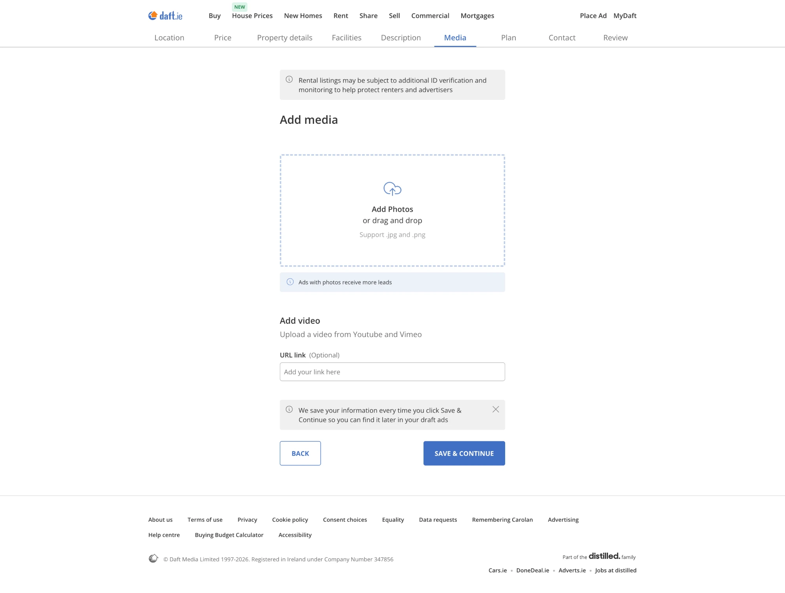

- "Add media": a dashed drop zone with an upload icon, "Add Photos or drag and drop", "Support .jpg and .png".
- Info strip: "Ads with photos receive more leads". Photos aren't marked "(Optional)", but the Review summary later shows a placeholder instead of a photo, so they seem to be optional.
- Nothing on how many photos to add, which comes first, or size limits.
- "Add video. Upload a video from Youtube and Vimeo", but the field takes a link, not an upload: "URL link (Optional)", placeholder "Add your link here".

## 8. Plan

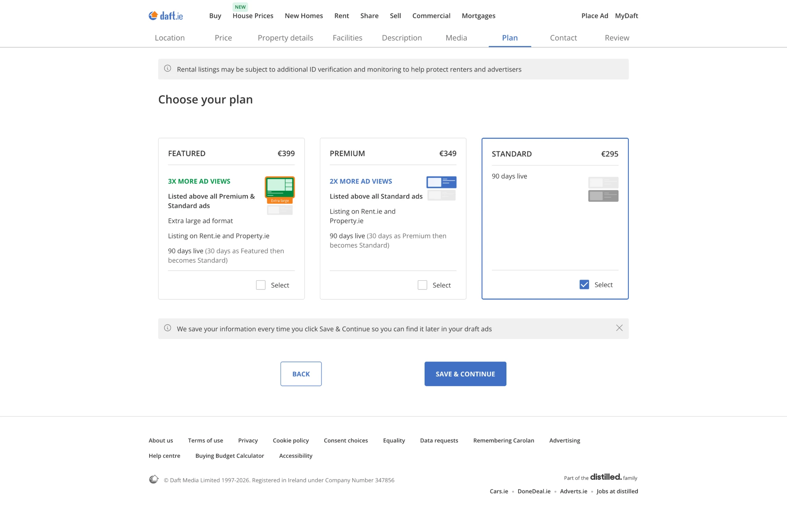

- "Choose your plan": three cards side by side, dearest first. The page widens to fit them.
- FEATURED, €399: "3X MORE AD VIEWS", "Listed above all Premium & Standard ads", "Extra large ad format", "Listing on Rent.ie and Property.ie", "90 days live (30 days as Featured then becomes Standard)".
- PREMIUM, €349: "2X MORE AD VIEWS", "Listed above all Standard ads", "Listing on Rent.ie and Property.ie", "90 days live (30 days as Premium then becomes Standard)".
- STANDARD, €295: "90 days live". Selected here (blue border, ticked).
- Each card has a small drawing of how the ad looks in the results, and a checkbox labelled "Select", though you choose one plan.
- Nothing says whether VAT is included, or where the "3X" and "2X" figures come from.

## 9. Contact

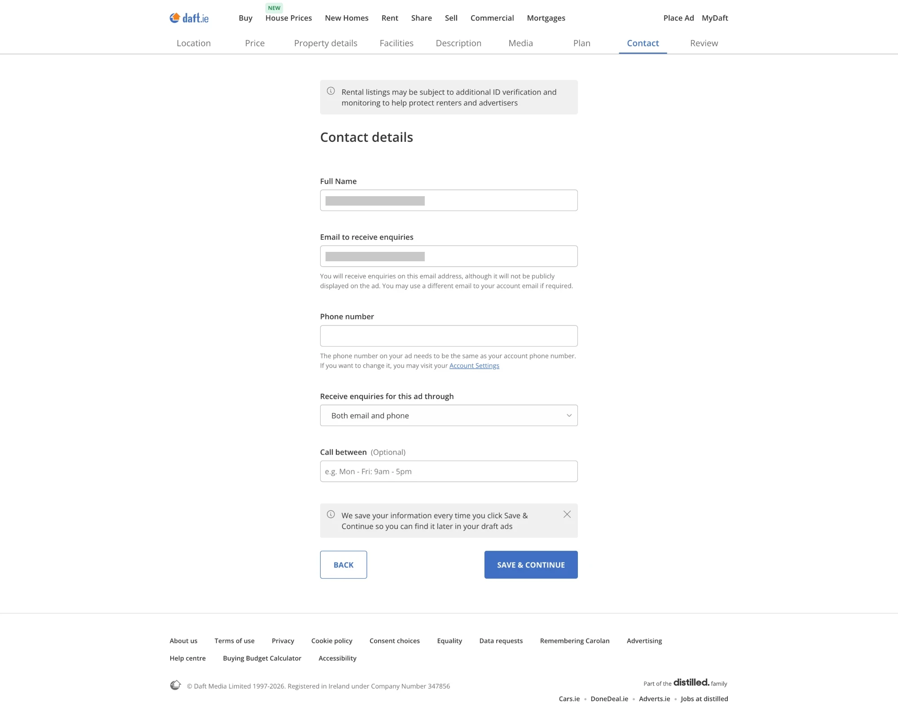

The account holder's name and email are blanked out in our copy.

- "Contact details": "Full Name" and "Email to receive enquiries" (both filled in here); "Phone number" (empty here); "Receive enquiries for this ad through", set to "Both email and phone"; "Call between (Optional)", placeholder "e.g. Mon - Fri: 9am - 5pm".
- Under the email: "You will receive enquiries on this email address, although it will not be publicly displayed on the ad. You may use a different email to your account email if required."
- Under the phone: "The phone number on your ad needs to be the same as your account phone number. If you want to change it, you may visit your Account Settings" (a link out of the flow).
- Enquiries arrive by email at one address and by phone at one number. Nothing here about a team or a shared inbox.

## 10. Review

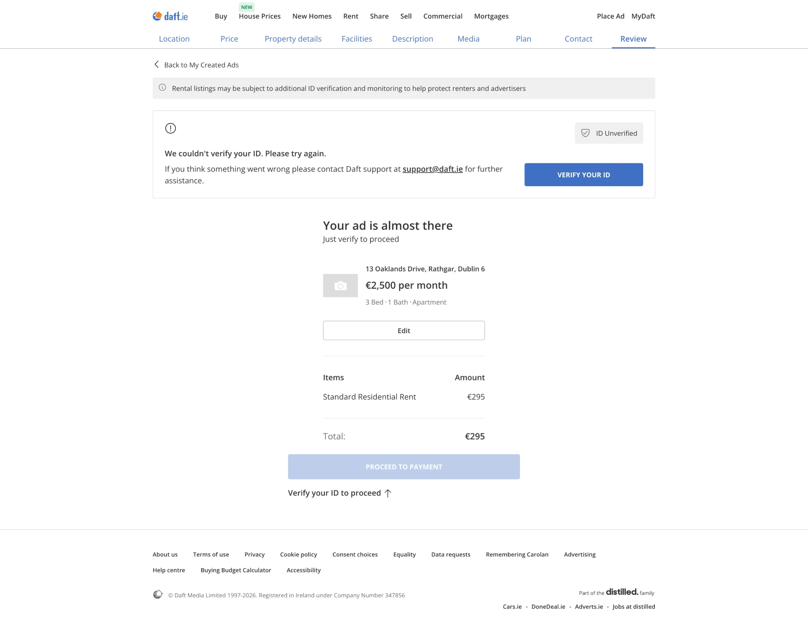

- "Back to My Created Ads" link at the top. Every tab label is now blue, as if all are done.
- A box at the top, marked "ID Unverified": "We couldn't verify your ID. Please try again. If you think something went wrong please contact Daft support at support@daft.ie for further assistance.", with a "VERIFY YOUR ID" button. (We don't know whether a check had been tried before this.)
- "Your ad is almost there. Just verify to proceed", then a summary of the ad: a grey camera placeholder, the address, "€2,500 per month", "3 Bed · 1 Bath · Apartment", and an "Edit" button. Nothing else from the earlier steps is shown.
- The bill: "Standard Residential Rent €295", "Total: €295". No VAT line.
- "PROCEED TO PAYMENT" is disabled, with "Verify your ID to proceed ↑" under it, pointing back up to the ID box.

## 11. ID check

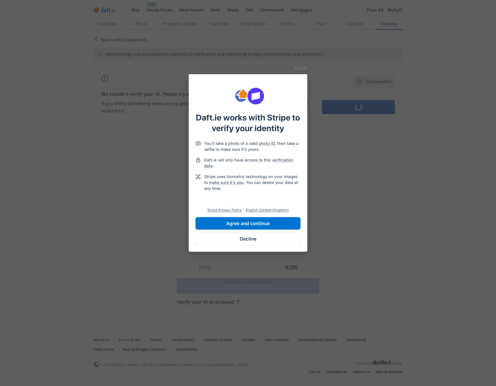

- "VERIFY YOUR ID" opens a Stripe window over the page: the Daft and Stripe logos, then "Daft.ie works with Stripe to verify your identity".
- Three points: "You'll take a photo of a valid photo ID, then take a selfie to make sure it's yours."; "Daft.ie will only have access to this verification data."; "Stripe uses biometric technology on your images to make sure it's you. You can delete your data at any time."
- "Stripe Privacy Policy" and a language link ("English (United Kingdom)"), then "Agree and continue" and "Decline". A pale "CLOSE" sits outside the window, above its top-right corner.
- The check is on the advertiser, not the renter. The banner on every step says ads "may be subject to" ID checks; here, payment is blocked until the check is done.

## Still to capture

Payment and publishing; the ad as renters see it; how a renter enquires; how enquiries reach the advertiser and are handled; the flow on a phone.
