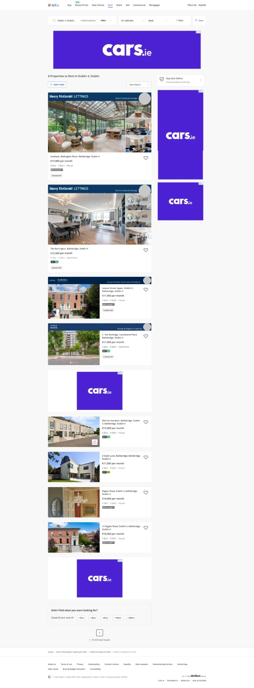

# Daft.ie: rent search results

Captured November 2026. Desktop, full-page screenshot. For renters: homes to rent in Dublin 4, filtered to €11,000 a month or more. Agents' names and photos are blanked out in our copy.

## Observations

- Search bar: location ("Dublin 4, Dublin…", "+ Add locations"), distance ("+0km"), "€11,000 Min", "Beds", "1 Filter" and "Save" (a heart, to save the search).
- "8 Properties to Rent in Dublin 4, Dublin", a "MAP VIEW" button and a "Best Match" sort.
- Three kinds of card, top to bottom, which appear to match the three plans in [place an ad](place-ad.md#8-plan):
  - two extra-large cards with the agency's banner, the agent's name and photo, and a grid of four photos;
  - two cards with the same banner and one photo;
  - four plain cards with one photo and no banner.
- Every card shows the address, the rent ("€13,000 per month"), beds, baths and type ("4 Bed · 4 Bath · House"), a BER badge (a rating such as A2 or C1, or "BER EXEMPT"), and a heart to save it. The first four also carry a "Luxury Let" tag.
- Nothing on the cards about when the home is free, how long the let is, or whether it's furnished. No enquiry button on the cards.
- Place names repeat in some addresses ("Ballsbridge, Ballsbridge, Dublin 4"; "Raglan Road, Dublin 4, Ballsbridge, Dublin 4").
- Cars.ie display ads: a wide banner under the search bar, two in the right-hand column and two among the results. Five ads for eight results.
- A "Stay Safe Online. Practical advice and tips" link at the top of the right-hand column.
- At the end: "Didn't find what you were looking for? Expand your search:" with buttons from "+1km" to "+20km", then "1 - 8 of 8 total results" and breadcrumbs.
