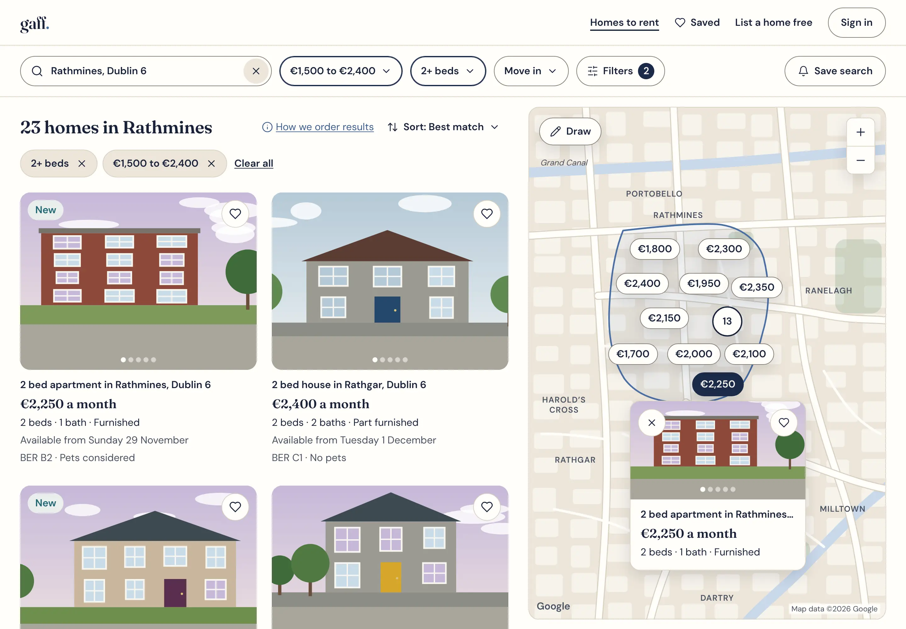
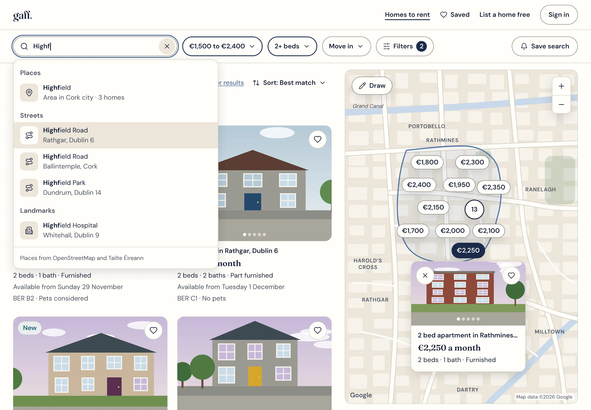
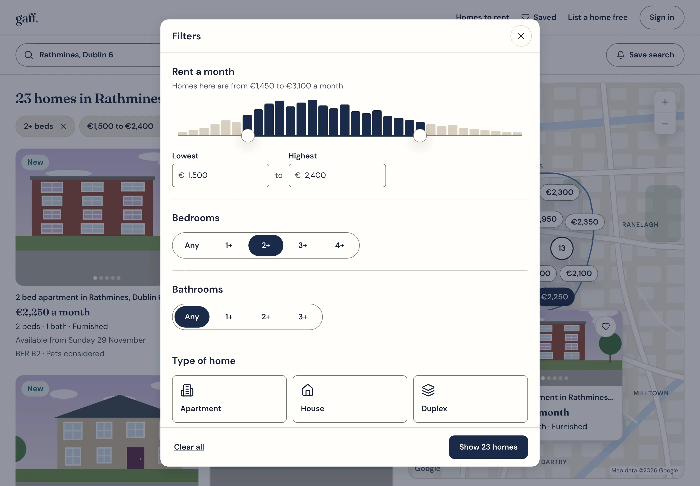
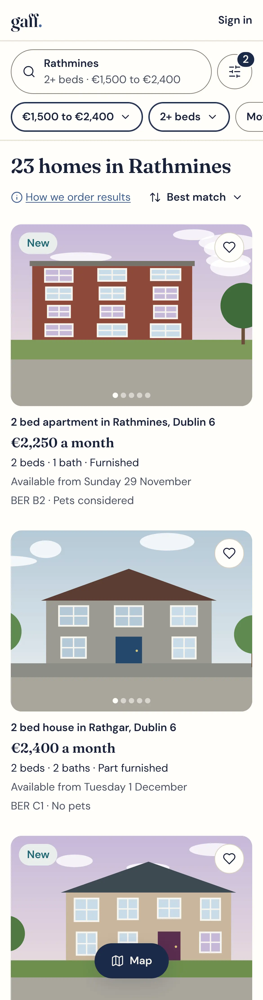
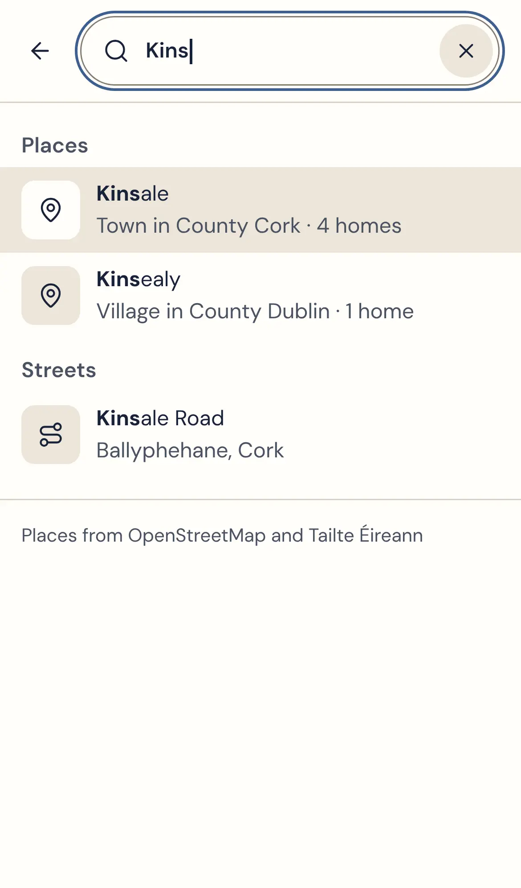
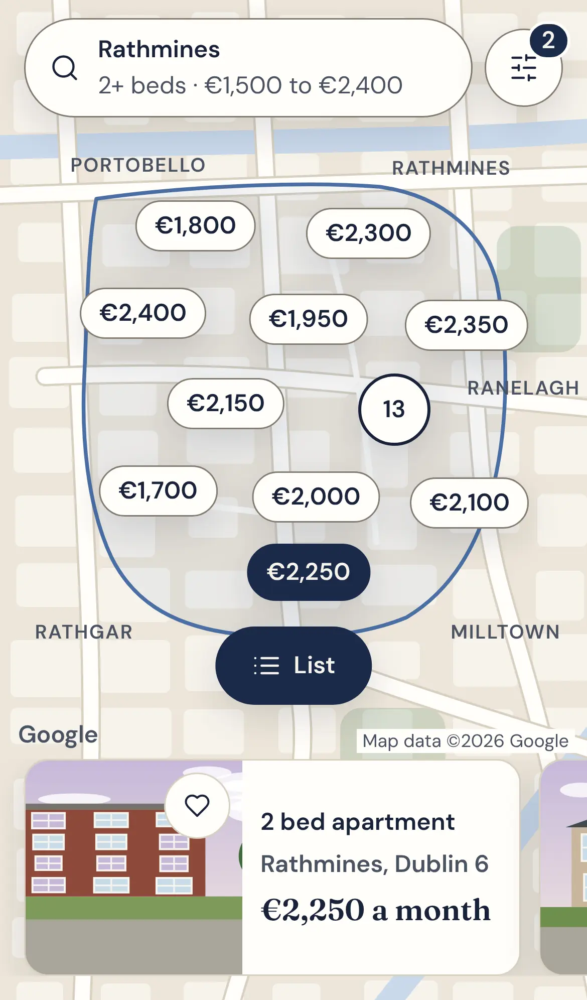
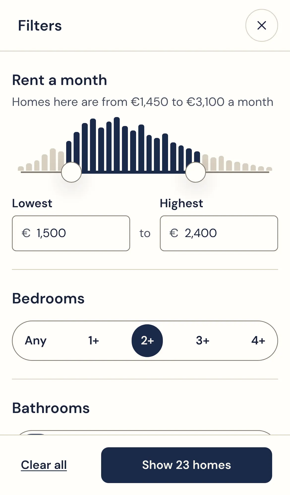

# Renter search redesign: product requirements

Decided by Sean on 8 November 2026 (Q57 to Q59 in [open-questions.md](../../open-questions.md)) · amends M56 to M61 and adds M113 to M124 in the [marketplace PRD](../prd.md) · goes with the [technical specification](tech-spec.md) and [ADR-0027](../../adr/0027-places-index-on-google-maps.md)

## Summary

Renters should be able to type any place in Ireland and see it suggested at once: a county, town, village, area, Dublin district, Eircode area, street or landmark. The results page should then work the way the best marketplaces do. A filter bar carries the filters people use most. One Filters sheet holds the rest and shows how many homes match as you choose. The list and a Google map sit side by side, and phones get the patterns renters already know from Airbnb and Zillow.

- **Why now:** today's search knows 136 hand-typed places, so "Kinsale" and "Highfield Road" find nothing. Filters hide in a panel that pushes the page down. Nothing changes until "Show homes" is pressed, and there's no map.
- **What we decided:**

| Question | Decision | Why |
| --- | --- | --- |
| What suggests places? (Q57) | Gaff's own index of every place, street and landmark in Ireland, built from open data, shown in Gaff's own dropdown | It's what property portals do (Zillow, Rightmove, Daft). Google's EU terms forbid showing Google's suggestions next to any map, including Google's, except through Google's own widget. Area pages and alerts need places we can store |
| Which map? (Q58) | Google Maps, showing only Gaff's own content | The map renters know best, used by Airbnb and Zillow. Google hosts the tiles, which removes the tile-hosting risk |
| Which layout? (Q59) | Zillow's filter bar with Airbnb's polish | It suits rentals: the controls renters use most are one tap away |
| How does it ship? (Q59) | Everything in one release, map included, behind a flag until it passes the release checks | Renters get the complete experience on day one |

- **Mockups:** [images](#mockups) of each screen, on Gaff's tokens.

## What's wrong today

From the test copy (8 November 2026) and the code in `src/app/(public)/to-rent/`.

| # | Problem | Effect |
| --- | --- | --- |
| 1 | Suggestions come from 136 hand-typed places (`src/domain/places/gazetteer.ts`). No villages, few towns, no streets, no landmarks | "Kinsale", "Highfield Road" and "near UCD" find nothing, and nothing says so while typing |
| 2 | Filters sit in a `<details>` panel labelled "Filters", which looks like a heading. Opening it pushes the results down by a screen | Renters miss the filters, or lose their place when they open them |
| 3 | Nothing updates until "Show homes" is pressed, and each change reloads the page | Renters can't see what a filter does |
| 4 | "Order" sits inside the search form, beside the submit button | Sorting reads as part of the search, not of the results |
| 5 | Applied filters show only as "Filters (3 on)" | Removing one means opening the panel and finding it |
| 6 | The count ("9 homes taking enquiries") is under the page title, far from the results and the filters | Renters can't tell how a change affects the number of homes |
| 7 | No map (M57 was never built) | Renters can't judge where homes are |
| 8 | Cards carry five or more pills of equal weight, and a Save button under the card | Busy cards, uneven heights, and saving doesn't look like saving |
| 9 | On a phone, the search panel fills the first screen | Results start below the fold |
| 10 | "Get alerts for this search" is a separate form between the search and the results | It interrupts the path from search to results |

## What the best marketplaces do

### Place search and maps

| Marketplace | Suggestions come from | Map | Evidence |
| --- | --- | --- | --- |
| Airbnb | Google Places | Google Maps | Search addresses carry Google place IDs (`place_id=Eh9IaWdoZmllbGQgUm9hZC…`); the map shows "Map Data ©2026 Google" |
| Zillow | Its own index of regions, neighbourhoods, schools and addresses, with Zillow region IDs | Google Maps | Suggestions mix places, schools and "homes" searches; the map shows "Map data ©2026 Google" |
| Rightmove | Its own location index (identifiers such as `REGION^87490`, `OUTCODE^2522`, `STATION^2156`) | Not checked | Its typeahead service returns those identifiers |
| Daft.ie | Its own list of areas, with "+ distance" and several areas at once | Not checked | [Our teardown](../../competitors/daft/rent-search.md) |

**What we take from it.** Property portals search their own index of places, because a place needs a boundary, a page that search engines find, and alerts that keep working. Airbnb is a travel site and uses Google Places. That set-up isn't open to Gaff. Google's EU terms, which apply because Gaff is billed in Ireland, forbid showing Places content "on, next to, or ... visually associated with any map, including a Google Map", except through Google's ready-made Places UI Kit widget. So Gaff follows Zillow: our own index, on a Google map.

### Search and filter patterns

These are the best practices the redesign follows.

1. **The most-used filters go in a bar, and everything else in one Filters sheet.** Zillow's bar has Price, Beds & baths, Property type and Filters. [Baymard](https://baymard.com/blog/promoting-product-filters) finds most sites fail to promote their important filters.
2. **Applied filters show as chips you can remove, with "Clear all".** Without this overview, mobile users must reopen the filters to undo one ([Baymard](https://baymard.com/research-articles/how-to-design-applied-filters)).
3. **Desktop applies filters as soon as they change. Phones collect them in a sheet with "Show 23 homes".** Live updates suit desktop; on phones they cause disorienting refreshes mid-task ([Baymard](https://baymard.com/blog/ecommerce-filter-ui)).
4. **Sort sits with the results, beside the count.** Zillow, Airbnb and Daft all do this.
5. **The count is in view wherever a decision is made:** above the results, and on the Filters sheet's button.
6. **List and map side by side on larger screens, kept in step:** hover a card and its pin lights up, and the reverse. On phones the list comes first, with a floating Map button (Airbnb).
7. **Moving the map searches the area in view, and says so** ("23 homes in this map area"). Airbnb and Zillow both do this.
8. **Draw an area:** Zillow's "Draw", and Daft's "You Map It".
9. **Suggestions are grouped by kind, with an icon, the typed part in bold, and context** ("Highfield Road · Rathgar, Dublin 6").
10. **Cards lead with a big photo you can swipe and a heart on the photo.** The rent stands out, with two or three short lines of facts below.
11. **Nothing that touches a protected ground.** Airbnb's "Who" control (adults, children, infants) isn't copied. Family status is a protected ground (rule 3), and the search never asks who is moving in.

## Goals and measures

| Goal | Measure | Target |
| --- | --- | --- |
| Renters find any place | A fixed test set of 1,000 Irish place names (towns, villages, Dublin areas, streets, landmarks, Irish names, names without fadas, common misspellings) with the right place in the top 3 suggestions | 98% or more; 100% for counties, cities, towns and Dublin districts |
| Suggestions feel instant | From a keypress to suggestions on a mid-range Android phone on 4G, p95 | 300 ms or less (the server's part: 100 ms or less) |
| Fewer dead ends | Searches with no place found | Under 2% |
| Renters reach homes | Searches that lead to a listing being opened | Up 25% on the two weeks before release, measured with the same first-party counts |
| Filters help, not trap | Searches that use a filter; filters removed with a chip | Tracked from release; targets once there's a baseline |
| Alerts | Searches saved per 100 searches | Tracked from release |
| Speed | p75 on phones: LCP, INP, CLS | 2.5 s, 200 ms, 0.1 or less |
| Accessible | WCAG 2.2 AA: axe in every state, plus a manual pass with VoiceOver on iOS and NVDA on Windows | No failures |
| Cost under control | Google Maps spend against the monthly budget the founders set | Alerts at 50%, 80% and 100%; never over |

## Who it's for

- **A renter on a phone**, short on time, who knows the areas they want, or wants to be near work or college. Budget and bedrooms are hard limits. The move-in date matters, and often pets.
- **A renter on a laptop**, comparing areas on a map and saving a search for alerts.
- **A renter who uses a keyboard or a screen reader.** Every pin's home is in the list, and every control works without a mouse.

## Principles for this redesign

1. **Type anything, find it.** Every place, street and landmark. Fadas are optional and typos forgiven.
2. **Every change answers at once,** with the count always in view.
3. **One obvious home for each control.** Search and filters at the top, sort with the results, save with the search.
4. **The list leads and the map helps.** Every home on the map is in the list, and the list works without the map.
5. **Calm.** No ads, no paid ranking, no dark patterns. Renters' devices call Google only when a map is on screen.
6. **Fair.** Filters are facts about the home, never about who the renter is.

## Scope

**In this release:**

- the search page and area pages (`/to-rent/…`);
- the Where box, its suggestions, and the place index behind them;
- the filter bar, the Filters sheet, chips, sort, cards, and pages of results;
- the map: side by side on larger screens, a map view on phones, "search the map area", and drawing an area;
- the Save search entry points, and the empty, loading and error states;
- the letter's map pin (M38). The map needs real points, and today homes get their area's centre.

**Next, using the same map:** the listing page's map with nearby transport and schools (M71).

**Not now:** commute time (M63), comparing homes (M64), typical rents (M65), "near me" by location, AI or natural-language search, and several areas at once (M123, Later).

## The experience

See the [mockups](#mockups). Breakpoints follow common practice: phones under 744px, tablets from 744px to 1127px, and desktops from 1128px.

### Desktop

```
┌──────────────────────────────────────────────────────────────────────────────┐
│ gaff.                     Homes to rent   Saved   List a home free   Sign in │
├──────────────────────────────────────────────────────────────────────────────┤
│ ( Q  Rathmines, Dublin 6   x )  +0 km v  [€1,500 to €2,400 v] [2+ beds v]    │  sticky
│                                          [Move in v] [Filters 2]  [Save search]
├───────────────────────────────────────────────┬──────────────────────────────┤
│ 23 homes in Rathmines                         │  ┌────────────────────────┐  │
│ [2+ beds x] [€1,500 to €2,400 x]  Clear all   │  │   map     (€2,250)     │  │
│                    Sort: Best match v  (i)    │  │  (€1,950)      (12)    │  │
│ ┌─────────────────┐ ┌─────────────────┐       │  │        [€2,600]◄ mini  │  │
│ │ photo         ♡ │ │ photo         ♡ │       │  │                 card   │  │
│ └─────────────────┘ └─────────────────┘       │  │ [Draw]          [+][-] │  │
│ 2 bed apartment in Ranelagh, Dublin 6         │  │ Google   Map data ©    │  │
│ €2,250 a month                                │  └────────────────────────┘  │
│ 2 beds · 1 bath · Furnished                   │        sticky, 42%           │
│ Available from Saturday 29 November           │                              │
│ … pages of 20 …                               │                              │
└───────────────────────────────────────────────┴──────────────────────────────┘
```

- **Header:** the site header, then a filter bar that sticks to the top as the page scrolls (M118).
- **Filter bar:**
  - the Where box (M56), with a distance control beside it when the place allows one (M113);
  - Rent, Beds and Move in buttons, each opening a small popover;
  - the Filters button, showing how many filters are on;
  - Save search, a secondary button with a bell.
- **Results column (58%):**
  - the count as the page's heading ("23 homes in Rathmines");
  - the applied-filter chips with "Clear all" (M115);
  - Sort, with "How we order results" beside it (M59);
  - cards two to a row (three from 1760px), then numbered pages.
- **Map column (42%):** sticky, with rounded corners. It holds:
  - price pins and clusters (M117);
  - a mini card for the chosen pin;
  - "Draw", and zoom;
  - Google's logo and terms, which are always visible (M119).
- **Changes apply at once** (M116). The list keeps the old results, dimmed with a thin progress bar, until the new ones arrive. Screen readers hear the new count.
- **The look** (as in the mockups):
  - the Where box, filter buttons, chips and segmented controls are pill-shaped (`radius-pill`); ordinary inputs keep `radius-sm`;
  - a set filter button has the 2px primary edge of a chosen choice card;
  - everything floating over the map (pins, clusters, Draw, zoom, the mini card, the phone search pill) has `shadow-overlay`; the rest of the page uses hairlines, as the design system says;
  - the outline of the searched area on the map is the screen's one Atlantic accent;
  - the site header adds "Saved" and "List a home free" beside "Homes to rent" and "Sign in".

### Tablet

The same filter bar, with cards two to a row and no map column. A floating "Map" button switches to the map, as on phones.

### Phone

```
┌──────────────────────────────┐     ┌──────────────────────────────┐
│ ( Q Rathmines · 2+ beds  (=2))│     │ ( Q Rathmines · 2+ beds  (=2))│
│ [Rent][Beds 2+][Move in][Pets]→│    │            map               │
├──────────────────────────────┤     │   (€1,950)   (€2,250)        │
│ 23 homes        Sort v       │     │        [€2,600]  (12)        │
│ ┌──────────────────────────┐ │     │                              │
│ │ photo                  ♡ │ │     │ ┌──────────────────────┐┌──  │
│ └──────────────────────────┘ │     │ │ photo  €2,600 a month││    │
│ 2 bed apartment in Ranelagh  │     │ │ 2 bed house, Rathgar ││    │
│ €2,250 a month               │     │ └──────────────────────┘└──  │
│ 2 beds · 1 bath · Furnished  │     │                              │
│          ( Map )             │     │          ( List )            │
└──────────────────────────────┘     └──────────────────────────────┘
```

- **The search pill** shows the search in words ("Rathmines · 2+ beds"). Tapping it opens the full-screen search sheet. The round button beside it opens the Filters sheet, with a badge for the number of filters on.
- **Quick-filter chips** scroll sideways: Rent, Beds, Move in, Pets and Type. Chips that are on look selected and come first. Each opens the Filters sheet at that filter, with "Show 23 homes" (amended in the build: one sheet, so every filter is a scroll away).
- **The list** is one card per row. A floating navy "Map" button switches to the map view. The map loads only then (M119).
- **The map view** is full screen, with the pill on top and a row of cards to swipe at the bottom, kept in step with the pins. "List" goes back. The web address remembers the view, so the Back button works.

### The Where box (M56, M113, M114, M121)

- **Before typing:** focusing the box shows the renter's recent searches (M114), then popular places, which are the places with the most homes (M121).
- **Typing two letters or more** shows up to 8 suggestions, grouped as Places, Streets and Landmarks:
  - each row has an icon, the name with the typed part in bold, and context: "Kinsale · Town in County Cork · 4 homes", "Highfield Road · Rathgar, Dublin 6", "St Vincent's University Hospital · Elm Park, Dublin 4";
  - streets and landmarks never crowd out places: at most 3 streets and 2 landmarks, unless nothing else matches;
  - groups appear in the order of their best suggestion, so the best match always comes first. For "Highf", the area Highfield in Cork leads; for "Highfield r", Highfield Road does.
- **Eircodes:**
  - a routing key ("P17", "D6W", "d06") suggests its Eircode area first: "P17 · Eircode area · Kinsale";
  - a full Eircode searches its routing key's area. Gaff doesn't hold the Eircode address database;
  - Dublin districts work as words too ("Dublin 6", "D6").
- **Forgiving:** "dun laoghaire" finds Dún Laoghaire, "Cionn tSáile" finds Kinsale, and "Rathmins" finds Rathmines.
- **No match:** the list says "We couldn't find ‘Kinsael’" and offers the closest names ("Did you mean Kinsale?"). Pressing Enter on unknown words shows the same message on the page, never an empty result.
- **Choosing a suggestion:**
  - a county, town, village, area, district or Eircode area opens its area page, keeping the filters;
  - a street or landmark opens a "near" search, "Homes near Highfield Road, Rathgar", within 1 km in a city and 3 km elsewhere, which the renter can change (M113).
- **Distance** (M113):
  - areas: "Only Kinsale", "+1 km", "+3 km", "+5 km", "+10 km" or "+20 km";
  - streets and landmarks: "Within 500 m", "1 km", "2 km" or "5 km".
- **Clear (×)** goes back to all of Ireland.
- **Keyboard:** ↓ and ↑ move through suggestions, Enter chooses, and Esc closes the list, then clears the text. Tab leaves without choosing.

### Filters (M58, M115, M116, M122)

- **Bar buttons** show their value when set, in words: "€1,500 to €2,400", "Up to €2,400", "2+ beds", "By Monday 1 December". A set button looks selected.
- **Desktop popovers** hold one control each, plus "Clear". A change applies at once.
- **The Filters sheet** is a dialog on desktop and full screen on phones. It holds every filter, in this order:
  1. Rent a month: lowest and highest, with a histogram of rents in this search (M122);
  2. Bedrooms: Any, 1+, 2+, 3+, 4+;
  3. Bathrooms: Any, 1+, 2+, 3+;
  4. Type of home: tiles with icons;
  5. Move in: available by a date;
  6. Furnishing;
  7. Must have: Pets considered ("Assistance dogs are always welcome"), Parking, Outdoor space;
  8. Energy rating (BER): this band or better;
  9. Accessibility;
  10. Listed: any time, in the last day, or in the last 7 days;
  11. Distance, when the place allows it.
- **The sheet's footer** has "Clear all" and "Show 23 homes". The count updates within 300 ms of a change, and screen readers hear it. Choices apply only when "Show 23 homes" is pressed. Closing with × or Esc keeps the search as it was.
- **Chips:**
  - on desktop, each applied filter is a chip, such as "2+ beds ×", in the results header, with "Clear all" after two or more;
  - on phones, chips that are on lead the row, and "Clear all" ends it.
- **Facts about the home only.** No filter, sort or suggestion uses anything about the renter (rule 3).

### Sort (M59)

A menu button beside the count, "Sort: Best match", offers Best match, Newest, Rent: lowest first and Rent: highest first. "How we order results" sits beside it, a promise that nobody can pay to be shown first.

### Cards (M60)

- A rounded photo (4:3) to swipe, with dots. On desktop, arrows appear on hover and focus.
- The heart sits on the photo, top right, and is a 44px button labelled "Save 2 bed apartment in Ranelagh".
- At most one status pill on the photo, top left: "New" (listed in the last 3 days), "Enquiries close Friday 6pm", or "You enquired".
- Below the photo, in plain text:
  - the title: "2 bed apartment in Ranelagh, Dublin 6";
  - the rent: "€2,250 a month", in Fraunces;
  - the rooms: "2 beds · 1 bath · Furnished";
  - the date: "Available from Saturday 29 November";
  - "BER B2 · Pets considered".
- The whole card opens the home's page. The heart and the photo arrows are separate buttons.
- Hovering or focusing a card lights up its pin on the map.

### The map (M57, M117, M119, M120)

- **Where it starts:**
  - on a place's page, the map fits the place;
  - on a "near" search, it fits the distance circle;
  - for all of Ireland, it shows the whole country with clusters.
- **What it shows:**
  - a pin for every matching home in view, not just this page of results. The pin shows the rent ("€2,250");
  - clusters with a count when zoomed out;
  - homes whose letter chose not to show the exact address appear at their approximate point, as on their page (M38).
- **Pins and cards:**
  - hovering or focusing a card lights up its pin, and the reverse;
  - choosing a pin opens a mini card (photo, rent, rooms, area), and the mini card opens the home's page.
- **Moving the map** searches the area in view. The heading becomes "23 homes in this map area" and the Where box shows "Map area ×". Clearing it goes back to the place.
- **Draw** lets the renter draw round an area with a finger or mouse. The results are the homes inside it, and "Remove shape" undoes it.
- **No business pins.** The map hides Google's business markers, so homes stand out. Transport lines stay.
- **If the map can't load** (blocked, offline or over quota), the list stays and says "The map isn't available right now. Every home is still in the list." (M120)
- **Google's logo, terms and "Report a map error" links** are never covered (M119).
- **On phones,** Google's script loads only when the renter opens the map. On larger screens, it loads after the results, once the map column is on screen.

### Save search and alerts (M61, M86)

- "Save search" in the bar opens the existing alert flow, with the name filled in ("2+ bed homes in Rathmines") and the alert set to "As soon as a home is listed". A renter who isn't signed in signs in and comes back to the same search.
- Once saved, the button reads "Saved" with a check.
- A map area or a drawn shape can be saved too.

### Empty, loading and error states

| State | What the renter sees |
| --- | --- |
| No homes match (M61) | "No homes match yet in Rathmines." Then up to three wider searches with their counts ("Up to €2,600: 4 homes", "+3 km: 6 homes", "Available by Monday 1 December: 2 homes"), and "Get alerts for this search. We'll email you as soon as one is listed." The map still shows the area |
| Place not found | "We couldn't find ‘Kinsael’. Did you mean Kinsale?" with the closest places, and popular places |
| Loading after a change | The old results, dimmed, with a progress bar. Screen readers hear "Loading homes", then "23 homes" |
| First load | Skeleton cards the same size as real ones, so nothing jumps |
| Suggestions unavailable | The box still works: Enter searches the best match on the server |
| Map unavailable | The list, with the message above (M120) |

### Words

Plain, warm and short, with no exclamation marks. Copy lives in `src/copy/search.ts`.

| Where | Words |
| --- | --- |
| Where box label and placeholder | "Where do you want to live?" / "Town, area, street or Eircode" |
| Count | "23 homes in Rathmines", "1 home near Highfield Road, Rathgar", "23 homes in this map area" |
| Filters sheet | "Filters", "Clear all", "Show 23 homes", "Show 1 home", "No homes match these filters" (with the button off) |
| Distance | "Only Kinsale", "+3 km", "Within 1 km" |
| Rent filter | "Homes here are from €1,450 to €3,100 a month" (above the histogram) |
| Move in filter | "Homes free on or before this date" |
| Save | "Save search", "Saved" |
| Map buttons | "Map", "List", "Draw", "Remove shape", "Skip the map" |
| Map unavailable | "The map isn't available right now. Every home is still in the list." |

### Accessibility

- **The Where box** follows the WAI-ARIA combobox pattern: a listbox of grouped options, the active option announced, and the number of suggestions in a polite live region.
- **Popovers** are non-modal and close on Esc or a click outside. **The Filters sheet** is a modal dialog: focus starts on its title, stays inside, and returns to the Filters button on close.
- **Every control is at least 44px.** Nothing a renter reads or acts on is under 16px. Text zooms to 200% without loss, and the page reflows at 320px. Only the chip row scrolls sideways, inside itself, and keyboard focus scrolls it.
- **Pins are buttons** named for their home ("€2,250 a month, 2 bed apartment in Ranelagh"). A "Skip the map" link jumps to the results. The list holds every home on the map.
- **Reduced motion:** the map jumps instead of gliding, and photos change without sliding.
- **Colours:** the chosen pin and selected chips use the navy and nav-ink pair. Any new text and background pairs are added to the contrast list in `docs/design-tokens.json` first.

## Requirements

The marketplace PRD's section G is updated to match.

### Amended

| ID | Requirement | Priority |
| --- | --- | --- |
| M56 | Search any place in Ireland: county, city, town, village, area, Dublin postal district, Eircode routing key, townland, street or landmark (colleges, hospitals, stations). Suggestions appear as they type, grouped by kind, and forgive missing fadas and typos. Or draw an area on the map | Must |
| M57 | List and map side by side on larger screens; on phones a Map button switches views. Moving the map searches the area in view. The map is Google Maps, showing only Gaff's own content | Must |
| M58 | Filters as before. Rent, Beds and Move in are in a filter bar, and every filter is in one Filters sheet with a live count. Filters live in the web address | Must |
| M59 | Order as before. Sort sits beside the results, not in the search form, with "How we order results" beside it | Must |
| M60 | Each result as before, with a photo to swipe, save on the photo, the facts in plain text, and at most one status pill | Must |
| M61 | When nothing matches, suggest wider searches with their counts, and offer an alert in the same place | Must |

### New

| ID | Requirement | Priority |
| --- | --- | --- |
| M113 | Distance: "+ km" around an area, "Within" for a street or landmark | Must |
| M114 | Recent searches: the last 5 for signed-in renters, kept with their account and deleted with it; this visit's searches for everyone else | Should |
| M115 | Applied filters as chips, each removable, with "Clear all" | Must |
| M116 | On larger screens, results update as soon as a filter changes. On phones, a sheet shows "Show 23 homes" with a live count | Must |
| M117 | Map pins show the rent. A card and its pin light each other up. Clusters show a count. A pin opens a mini card | Must |
| M118 | The search bar stays at the top as the page scrolls | Must |
| M119 | Google's map loads only when it's on screen, and renters' devices don't call Google otherwise. Google's attribution is always visible | Must |
| M120 | When the map can't load, the list still works and says so | Must |
| M121 | Popular places in the Where box, and home counts beside areas | Should |
| M122 | A histogram of rents in the Rent filter | Should |
| M123 | Search several areas at once ("Rathmines, Ranelagh") | Later |
| M124 | Places that renters couldn't find are counted, with no user, device or digits kept, so the index can be improved | Must |

M38 (the letter places the pin) stays a Must and moves into this release, because the map needs real points.

## Release

- **One release** (Q59). Amended in the build: no `SEARCH_V2` flag. The redesign replaces the old page on its own branch, because the old page ran on the hand-typed place list the index replaces; the branch reaches the test copy only once it passes every check:
  - the place test set: 98% or more;
  - an end-to-end journey with axe for every state, on a phone and a desktop;
  - the speed budgets on a mid-range phone;
  - Google Maps set up: billing in Gaff's name, keys restricted, budget alerts, the privacy notice and terms updated, and the DPIA updated;
  - the founders' walkthrough on a phone and a laptop.
- **Then** the branch merges. The hand-typed places stay as the index's curated base, so area pages keep their addresses.

## Open questions

| # | Question | Proposal | Who |
| --- | --- | --- | --- |
| S1 | The monthly budget for Google Maps | Start at €300 a month, with a daily quota cap, and review it at launch. That covers about 50,000 map loads: the first 10,000 a month are free, then about $7 per 1,000. Most phone visits never load the map | Founders |
| S2 | Does the map need a "Show the map" tap the first time? | Decide after the spike lists what Google's script stores on the device, and after the DPIA. A one-tap design is ready if needed | Solicitor, CTO |
| S3 | Are townlands searchable? There are about 61,000 of them, and many names repeat | Yes, ranked last and always shown with their town and county | Founders |
| S4 | When does searching several areas at once (M123) come? | After launch, by demand | Founders |

## Mockups

Static pages on Gaff's own tokens, fonts and house drawings, in [mockups/](mockups/), with these screenshots. The map is a placeholder for Google's, and every home is made up. The distance control beside the Where box isn't drawn.

**1. Desktop results:** the filter bar with two filters set, the count, chips and sort, and the list and map side by side. The chosen home's pin is navy, with its mini card.



**2. The Where box:** "Highf" typed, suggestions grouped with the best group first, the active row highlighted, and the data credit at the foot.



**3. The Filters sheet on desktop:** the rent histogram and range, Bedrooms and Bathrooms, Type of home, and "Clear all" and "Show 23 homes" in the footer.



**4. Phone results:** the search pill with the filter badge, the quick-filter chips (set ones first), the count and sort, cards, and the floating Map button.



**5. Phone search:** "Kins" typed. Kinsale, the town in County Cork, comes first.



**6. Phone map:** pins, a cluster and the chosen home, the card row, and the List button. The card row sits below the map's edge, so Google's logo stays visible.



**7. The Filters sheet on a phone:** full screen, with the footer always in view.



## Sources

- [Baymard: promoting important filters](https://baymard.com/blog/promoting-product-filters)
- [Baymard: display applied filters in an overview](https://baymard.com/research-articles/how-to-design-applied-filters)
- [Baymard: what is an ecommerce filter? (desktop and mobile application)](https://baymard.com/blog/ecommerce-filter-ui)
- [Google Maps Platform EEA Service Specific Terms](https://cloud.google.com/terms/maps-platform/eea/maps-service-terms) (definition of "With any Map"; Places API sections 15.1 to 15.4)
- [Places API EEA Permitted Uses](https://cloud.google.com/terms/maps-platform/eea-places-api-permitted-uses)
- [Google Maps Platform EEA Terms of Service](https://cloud.google.com/terms/maps-platform/eea) (section 3.2.2, notices; section 4.5, Controller-Controller Data Protection Terms)
- [Rightmove's location identifiers (third-party guide)](https://scrapfly.io/blog/posts/how-to-scrape-rightmove)
- [Zillow location suggestions (third-party API reference)](https://docs.scrapebadger.com/api-reference/endpoint/zillow/autocomplete)
- [WAI-ARIA Authoring Practices: combobox](https://www.w3.org/WAI/ARIA/apg/patterns/combobox/) and [dialog](https://www.w3.org/WAI/ARIA/apg/patterns/dialog-modal/)
- Screens of Airbnb and Zillow shared by Sean on 8 November 2026 (not stored)
