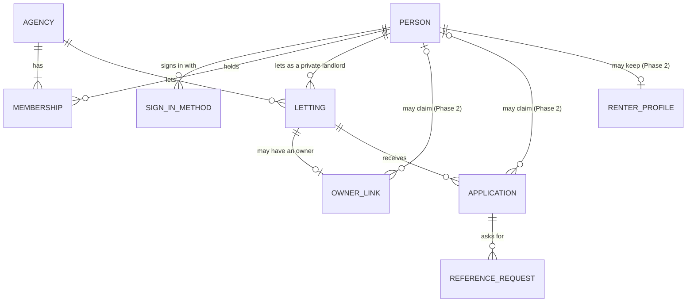

# 2. Accounts, roles and sign-in

Part of the [UX redesign PRD](README.md). This file replaces the "operator workspace" with a person-first account model, and specifies sign-in, first-run set-up, agencies, invites, owners and switching roles.

Requirement IDs: `UX-SI` (sign-in), `UX-AC` (accounts and set-up), `UX-AG` (agencies and teams), `UX-OW` (owners' accounts). Screens covered: 01-sign-in, 02-welcome, 03-welcome-error.

## What changes

| Today | Redesign |
| --- | --- |
| Sign-in by email link only. The link can open in another browser and break the flow. | Google, Apple, or a six-digit code by email. A passkey is offered after the first sign-in. |
| A tagline under the sign-in card. | No product description anywhere in sign-in or set-up. |
| "Set up your workspace": name, agency or landlord, business name and PSRA licence on one card. | One question per step. A landlord answers one. An agency answers two and confirms its licence from a lookup. |
| The PSRA licence is typed, in a field narrower than the others. | The agency is found by name on the public register. Nobody types a licence number. Every field is the same standard component. |
| An "operator" is the only kind of account. Renters and owners have links only. | Every person has one profile. An agency is a business that people belong to. Links still work for renters, owners and referees with no account. |
| Bank details and usual times sit in Settings from day one. | Each is asked for at the step that needs it. |

## The account model

One rule: **a person signs up once, and what they can do depends on what they do, not on what kind of account they chose.**

| Thing | What it is | Who creates it | Needs an account? |
| --- | --- | --- | --- |
| **Person** | One human: name, email, sign-in methods, phone if given | Anyone who signs in | It is the account |
| **Agency** | A business that lets homes for owners: name, PSRA licence, members, the name renters see, where tenants pay, its settings | A person, at set-up | Yes |
| **Membership** | A person's place in an agency, as Admin or Agent | An admin's invite | Yes |
| **Letting** | One home being let. Run by exactly one agency or one private landlord. Has one lead (the member responsible) | An agent, admin or private landlord | Yes |
| **Owner link** | The owner's read-only view of a letting an agency runs for them, and their approval of the tenant | The agent, by entering the owner's email | No. A private link. An owner can attach it to a profile later (Phase 2) |
| **Application** | One renter's enquiry and everything after it, for one letting. The operator's copy | Arrives with the enquiry | No. A private link |
| **Renter profile** | Details a renter chooses to keep for next time. Gaff is its controller (Q25) | The renter, by opting in | Yes (Phase 2) |
| **Reference request** | One form for one referee | The chosen applicant | Never |

**UX-AC-1.** A person has exactly one profile, however many roles they hold. Signing in with a second method that carries the same verified email joins the same profile. `[P7, P6]`

**UX-AC-2.** A person can, on one profile: belong to one or more agencies; let their own homes as a private landlord; and, from Phase 2, keep a renter profile and follow homes they own. None of these is chosen at sign-up, and none blocks another. `[P8]`

**UX-AC-3.** Renters, owners and referees never need an account to do anything a letting asks of them. A profile is offered as a benefit and is never a gate. `[P8, P14 · R9, R19]`

**UX-AC-4.** A private landlord's lettings are stored in an organisation of one, created silently when they add their first home. It has no name, no set-up screen and no settings page of its own. This keeps today's tenant isolation (`organisation_id` and row-level security on every table) unchanged. `[P7, P3]`

### What a person needs, and when

Nothing is asked before the action that needs it.

| To do this | Gaff needs | Asked when |
| --- | --- | --- |
| Enquire, answer questions, book, apply, accept an offer, sign | Nothing beyond what the stage collects. No account | Never |
| Give a reference | Nothing. No account | Never |
| Follow or approve as an owner | Nothing. No account | Never |
| Sign in | A Google or Apple account, or an email address | Sign-in |
| Start adding a letting | A name | First run, if sign-in didn't supply it |
| Put a letting live, as a private landlord | A tick: "I own this home, or I'm letting it for myself" | The go-live step of their first home |
| Put a letting live, as an agency | The agency confirmed (see below) | The go-live step of the agency's first home |
| Send a payment request | The account tenants pay into | The payment step of the first tenancy |
| Generate the tenancy agreement | The owner's name | The agreement step |
| Pay Gaff (after the pilots) | A card or direct debit | Before the first offer is sent on the first paid letting |
| Keep details for next time (renter, Phase 2) | A sign-in | The moment they tick "Keep my details" |

### Stored once, used everywhere

| Stored on the profile | Reused when |
| --- | --- |
| Name, email, phone | Every role. Never asked twice |
| Sign-in methods and passkeys | Every role |
| A check result a renter chose to keep (Phase 2, opt-in) | Offered to the next operator only when the renter is their chosen applicant or backup, with the renter's yes each time. Operators can't see who holds one before choosing. A "Verified" badge for private landlords follows in Phase 3 |
| A renter's answers and preferences (Phase 2, opt-in) | Pre-filled on their next application, for them to confirm |
| An agency's confirmation | Every letting the agency runs |
| Where tenants pay | Every tenancy for that agency or landlord |

**UX-AC-5.** Nothing a person does in one role is visible to another role's audience. An agency never sees a member's renter profile or personal lettings. An operator sees a renter's kept details only through an application to that operator's home, and identity, income and references only when the renter is the chosen applicant or the backup. `[P3 · rules 2 and 9]`

## Sign-in

One screen for new and returning users. The title is "Sign in or create an account".

| Order | Element | Notes |
| --- | --- | --- |
| 1 | "Continue with Google" | Standard branded button |
| 2 | "Continue with Apple" | Standard branded button |
| 3 | "or" divider | |
| 4 | Email field and "Continue" | Sends a six-digit code |
| 5 | One line of small print | Links to the terms and the privacy notice |

**UX-SI-1.** Sign-in offers three methods the user chooses between: Google, Apple, and email with a one-time code. There are no passwords. `[P6, P14]`

**UX-SI-2.** The email path sends a six-digit code. The next screen is one code input, with the keyboard set to numbers, that accepts a paste and submits itself when complete. The code lasts 10 minutes and allows five tries. "Send a new code" unlocks after 30 seconds. "Use a different email" goes back. `[P6, P10]`

**UX-SI-3.** The same email carries a button that signs the user in when opened on the same device and browser. Opened anywhere else, it shows the code in large type to enter where they started. Nobody is left signed in on the wrong browser. `[P6]`

**UX-SI-4.** After a first successful sign-in on a device that supports it, one sheet offers a passkey: "Sign in faster next time" with the device's own wording (Face ID, fingerprint, Windows Hello). "Not now" is remembered for 30 days. `[P6, P8]`

**UX-SI-5.** A returning user with a passkey is offered it first, through the browser's own passkey prompt on the email field. The other methods stay on the screen. `[P6]`

**UX-SI-6.** The screen shows which method the user chose last on this device ("You used Google last time"). `[P7]`

**UX-SI-7.** The sign-in screen carries no description of Gaff, no tagline and no illustration. `[P4]`

**UX-SI-8.** New and returning users take the same path. If no profile exists for the verified email, one is created and first-run set-up starts. Nobody is told "no account found". `[P14]`

**UX-SI-9.** A session lasts 30 days from last use on that device. `[P10]`

**UX-SI-10.** Three actions ask the user to confirm it's them again (passkey, or a fresh email code), whatever the age of the session: changing the account tenants pay into, removing a member, and deleting an agency. Changing where money goes is the fraud that matters most here. `[P6 · R23]`

**UX-SI-11.** Apple's "Hide My Email" is supported. Where an invite was sent to a different address, the invitee confirms the invited address with a code once. `[P6]`

**UX-SI-12.** Private links for renters, owners and referees work as today (ADR-0013). Pages that show check results or bank details ask for a one-time code sent to the person's email, as ADR-0013 already plans. `[P6 · rule 2]`

Why these methods: Google and Apple are one tap and cover most phones and most small-business email. An emailed code keeps the user in the tab they started in, which a link doesn't. Passkeys are the fastest and safest return path but are a poor first step for people who haven't met them, so they're offered after sign-in, not before. Published comparisons of these methods are thin and mostly from vendors, so the mix is a hypothesis: measure completion by method from day one ([section 9](09-activation-growth-measures.md)). Many Irish agencies run on Microsoft 365. "Continue with Microsoft" is added in Phase 2 if more than one in five pilot users signs in with an Outlook or Microsoft-hosted address.

### States

| State | What the user sees |
| --- | --- |
| Wrong code | Under the input: "That code isn't right. Check the email and try again." The input clears |
| Code expired or too many tries | "That code has expired." with "Send a new code" as the primary button |
| Google or Apple cancelled | Back on the sign-in screen, no error |
| Email didn't send | "We couldn't send the code. Check the address and try again." at the email field |
| Loading | The pressed button shows progress and the others are disabled |

## First run

Shown once, after the first sign-in, unless the person arrived by an invite. One question per screen, a segmented progress bar, Back and Next in a fixed footer.

| Step | Screen asks | Answered by | Skipped when |
| --- | --- | --- | --- |
| 1 | "What's your name?" | One field, first and last | Google or Apple supplied it |
| 2 | "What brings you to Gaff?" | Two large choice cards with icons: **I'm letting a home I own** / **I work at a letting agency**. A quiet link below: "I'm looking for a home to rent" | Never |
| 3 (agency only) | "Which agency?" | A search field over the PSRA register. Pick one | Never |
| 4 (agency only) | "Is this your agency?" | A card with the agency's registered name, licence number, licence type and county, and "Yes, that's us" | Never |

Then: a private landlord lands in "Add your home". An agency user lands on Today with the setup checklist, its first step "Add your first letting".

**UX-AC-6.** First-run set-up asks one question per screen and never more than four. A private landlord answers at most two. `[P2, P8]`

**UX-AC-7.** A private landlord is never asked for a business name or a licence. `[P7, P10]`

**UX-AC-8.** "I'm looking for a home to rent" opens a short page: "You don't need an account. If an agent or landlord uses Gaff, you'll get a link by email." It is not a dead end: the page says what to do next. (Phase 2 replaces it with the renter's home.) `[P4]`

**UX-AC-9.** The step that sets the name renters will see is deferred. An agency's registered or trading name is used. A private landlord is asked "What should renters call you?" at their first go-live, pre-filled with their first name. `[P8]`

**UX-AC-10.** The user can leave set-up at any step and return to where they were. `[P10]`

### Should set-up be a conversation?

**Recommendation: no chat. Use the assistant's voice, with taps.**

Set-up is two to four short answers, and two of them are a choice between cards. A chat would add typing, waiting and reading for the same answers, and people who aren't confident with software find an open text box harder than two large buttons. What a conversation is good for is turning a lot of loose information into structure. That problem is in adding a letting, and it's solved there by "Tell Gaff about the home" ([section 4](04-operator-flows.md#adding-a-letting)).

What set-up keeps from the conversational idea: each screen is phrased as a question from the assistant ("Let's get you started. What brings you to Gaff?"), one at a time, in plain words.

## Confirming an agency

The PSRA publishes its register of licensed property services providers and updates it weekly, as a download. Gaff keeps a copy and refreshes it each week.

**UX-AG-1.** The agency is found by typing its name. Results show the registered name, any trading name, the county and the licence number. Only businesses licensed to let (category C) are offered. `[P7 · rule 5]`

**UX-AG-2.** If the name isn't found, two links: "Enter the licence number instead" and "We're applying for a licence". The second lets the user set everything up; lettings can't go live until a licence is found. `[P10]`

**UX-AG-3.** If the agency is already on Gaff, the screen says so and offers one action: "Ask to join". The request goes to that agency's admins. `[P7]`

A public licence number proves nothing about the person who picked it. Confirmation comes in three layers:

| Layer | What it proves | How | When |
| --- | --- | --- | --- |
| 1. The licence | The agency exists and is licensed to let | Match to the register | At set-up, instantly |
| 2. The first admin | This person acts for that agency | Gaff checks once, by a person: the admin's email domain against the agency's own website or adverts, or a call back to the phone number the agency publishes | Before the agency's first letting goes live. Target: within one working hour |
| 3. Every other member | This person works there | An admin invited them, or approved their request to join | When they join |

**UX-AG-4.** Until layer 2 is done, the agency is "being confirmed". The admin can add lettings, import adverts, set viewing times and invite colleagues. The only thing held is go-live: the go-live step says "We're confirming Halcyon Lettings. This usually takes under an hour. We'll email you, and this home will go live then." `[P8, P9]`

**UX-AG-5.** Pilot agencies are confirmed before they arrive. A founder creates the agency and sends the first admin an invite, so they answer no set-up questions at all. `[P7]`

**UX-AG-6.** Gaff re-checks each agency against the register every week. If a licence lapses, the admins are told at once, live lettings carry on, and no new letting can go live until it's renewed. `[rule 5]`

**UX-AG-7.** The agency's name and PSRA licence number appear in the footer of every renter and owner page for its lettings, and in the tenancy agreement. `[P12]`

Why a person checks, for now: there are a few hundred letting agencies in Ireland and ten pilots. One check per agency, ever, is cheap, and it's the only method that works for an agency on a Gmail address. Automating it comes later, with the agency proving its email domain by a DNS record, which it also needs in order to send from its own address (Q16).

Individual agents also hold their own PSRA licences. Whether Gaff must check each agent's is a question for the solicitor ([section 12](12-phasing-and-decisions.md), OQ-4). The design leaves room for it: a "Licensed" line on the member's profile, matched to the register by an admin.

## Agencies: roles and permissions

Two roles. Every agency has at least one admin.

| Can they… | Admin | Agent |
| --- | --- | --- |
| See every letting the agency runs | Yes | Yes |
| Add a letting, and run any letting they lead | Yes | Yes |
| Act on a letting someone else leads | Yes | Yes, after tapping "Help with this letting". The record shows who did what |
| Make the three decisions (who views, who is offered, what is signed) | Yes | Yes |
| Change a letting's lead | Yes | Their own only |
| Invite and remove members, change roles | Yes | No |
| Change agency settings: the name renters see, the income rule, whether drafts wait for approval, the standard agreement | Yes | View only |
| Change where tenants pay | Yes, with re-confirmation | No |
| See "Everyone" on Today and the agency's results | Yes | No |
| Billing (after the pilots) | Yes | No |

**UX-AG-8.** Every member of an agency can see every letting it runs. Small agencies cover for each other, and a letting must never stall because one person is out. `[P1 · DJ1]`

**UX-AG-9.** Every letting has one lead. Today shows a person what they lead. The lead is whoever added the letting until someone changes it. `[P5]`

**UX-AG-10.** A landlord who lets several of their own homes with help (a portfolio landlord with staff) uses the same structure as an agency: a team with admins and agents, a name renters see, no PSRA licence. They reach it from the account menu ("Add someone to help") and are asked for a team name then. `[P8]`

### Inviting people

| Step | Screen | Primary action |
| --- | --- | --- |
| 1 | "Invite your team": one field that takes several emails, typed or pasted. Role defaults to Agent, with Admin one tap away | Send invites |
| 2 | The team list, with each invite shown as "Invited · sent today" and "Send again" and "Cancel" behind a menu | None |

**UX-AG-11.** An invite email says who invited them and to which agency, and has one button. It opens sign-in with "Join Halcyon Lettings" as the title and the email filled in. After sign-in they land on Today, in the agency, with no questions. `[P7, P8]`

**UX-AG-12.** Invites last seven days and can be sent again or cancelled. An invite works once. `[P6]`

**UX-AG-13.** "Invite your team" is prompted at three moments: in the admin's setup checklist; on Today when an admin is the only member and has a live letting; and on a letting's menu as "Share with a colleague". `[P9]`

**UX-AG-14.** Phase 2: an admin can let anyone with the agency's email domain ask to join. An admin still approves each one. `[P7]`

### When an agent leaves

| Step | What happens |
| --- | --- |
| 1 | An admin opens Team, picks the person, and chooses "Remove from Halcyon Lettings". Gaff asks the admin to confirm it's them |
| 2 | If the person leads open lettings, one screen lists them with a new lead pre-selected (the admin). The admin can change each, then confirms |
| 3 | At once: the person's sessions for the agency end; they can't open any agency page; their viewings and waiting tasks move to the new leads; messages they'd scheduled still go, from the agency |
| 4 | The record keeps what they did, by name while names are kept, so the agency can stand over past decisions |
| 5 | Their own profile is untouched. Anything personal (their own lettings, a renter profile) stays theirs. The agency can't see it and never could |

**UX-AG-15.** Removing a member takes effect immediately and can't leave a letting without a lead. `[P10 · DJ2]`

**UX-AG-16.** The last admin can't be removed or leave until another member is made admin. `[P10]`

**UX-AG-17.** A member can leave an agency themselves from their profile. Their lettings go to an admin, who is told. `[P6]`

## Owners

When an agency lets a home for its owner, the owner is not a member of the agency and never sees the workspace.

**Recommendation: owners keep the private link, and can attach it to a profile from Phase 2.** The link is what makes "approve in one tap from an email" work, and most owners have one home with one agent. A profile helps the owner with several homes or agents, who wants them in one place.

| | Owner (agency lets for them) | Private landlord |
| --- | --- | --- |
| How they arrive | The agent adds their email to the letting. Gaff emails a private link | They sign up |
| Account needed | No | Yes |
| What they see | Where the letting is, the numbers, what's been decided and why, with renters as "Applicant 1". From the offer stage, the chosen applicant and backup by name with their check results in words | Everything: every enquirer by name, every message, every result for the chosen applicant |
| What they decide | One thing: approve or decline the chosen tenant | All three decisions |
| What they can't do | Message renters, change anything, see contact details or message text | Nothing is hidden from them beyond the staged-data rule |
| After the home is let | A one-page summary: days to let, rent, registration date | Results on the letting |

**UX-OW-1.** The agent can invite the owner at any point after the letting is created, by entering a name and an email. It's prompted once, just after go-live ("Letting this for an owner? Let them follow along"), and required only at the offer. `[P8, P9 · R19, R27]`

**UX-OW-2.** The owner's invite today hides on the Timeline tab. It moves to the letting's menu as "Share with the owner" and to the prompt above. `[P5]`

**UX-OW-3.** Phase 2: the owner's page offers "Keep your homes in one place". Signing in with the invited email attaches every owner link sent to that email to their profile. Nothing changes about what they can see. `[P8]`

**UX-OW-4.** The agent can stop sharing at any time, as today. `[R27]`

## Switching roles

**UX-AC-11.** A person with more than one context sees them listed at the top of the account menu: each agency by name, "My own homes", and from Phase 2 "Renting" and "Homes I own". One tap switches. Gaff reopens the context they used last. `[P6, P3]`

**UX-AC-12.** A person with one context never sees a switcher. `[P3]`

**UX-AC-13.** A new context is added from the account menu: "Let a home I own", "Join or set up an agency". Each starts at the step that context needs and reuses the name and sign-in already on the profile. `[P7, P8]`

**UX-AC-14.** A member who applies, as a renter, for a home their own agency lets can't open that letting in the workspace, and an admin is told there's a conflict. (Phase 2, with renter profiles.) `[rule 1]`

## How this compares with Daft

People in this market know Daft. Where Daft's pattern is good, Gaff matches it, so nothing needs learning.

| | Daft | Gaff |
| --- | --- | --- |
| Individuals | One account both searches and places a private advert | The same: one profile for renting and letting |
| Private landlords | Verify a mobile number by code, then pay by card to advertise | No payment and no check to start. A tick at go-live. Identity checks arrive only if Gaff hosts public listings (Phase 3) |
| Agents | A separate agency registration and a separate agent login | One sign-in for everyone. The agency is something you belong to, not a second login |
| Renters | Send a free-text enquiry. Nothing carries to the next enquiry | No account needed. An optional profile carries their details forward (Phase 2) |

These points about Daft come from its help pages and public reports, not from testing a live account. Check them against a live account before the design is final.

## What's deferred

| Item | Until |
| --- | --- |
| Renter profiles, owners' profiles, the "Renting" and "Homes I own" contexts | Phase 2 |
| Continue with Microsoft; joining by email domain; a list of signed-in devices | Phase 2 |
| Keeping a check result for the next application | Phase 2 |
| "Verify once" ahead of any application; a landlord's "Verified" badge | Phase 3 |
| Checking each agent's own PSRA licence | The solicitor's answer |
| Billing details | After the pilots |

## Notes for the build

- The current sign-in library, Better Auth, supports Google and Apple sign-in, email one-time codes, passkeys, and organisations with invitations and roles. Confirm each against the version pinned in `package.json`.
- This replaces ADR-0013's "operators sign in by email link". Write a new ADR for it. Renter, owner and referee links are unchanged.
- The PSRA register names individuals, so Gaff's copy is personal data. Keep only what the lookup needs for businesses, acknowledge the source as the PSRA's re-use terms ask, and add it to the DPIA.
- `Organisation` gains a kind for the silent, one-person private landlord. The existing "landlord" kind becomes the landlord team.
