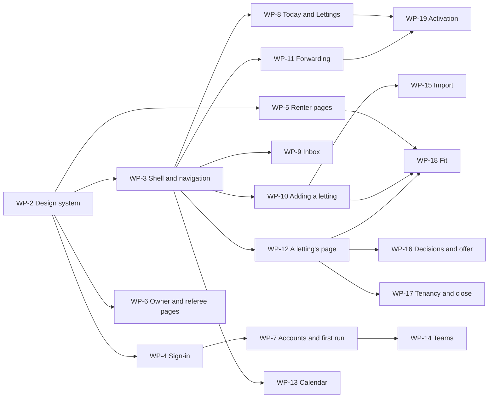

# 13. Work packages

Part of the [UX redesign PRD](README.md). This file splits Phase 1 into packages small enough to hand to one designer, one engineer or one sub-agent each. Every package names what to read, what to deliver, what it depends on and when it's done.

## How to use this

- One package, one owner. A package is finished when its "Done when" is true.
- Each package's reading list is the whole brief. Its owner reads those sections, plus sections 1 and 8, plus `CLAUDE.md`.
- Packages in the same wave can run side by side. A package starts when the packages it depends on are done.
- Where design comes before code, the design deliverable is the package's screens at 390px and 1280px wide, in light, built from the components in section 8, with every state in the flow's states table.

### Rules for every package

1. `CLAUDE.md`'s product rules hold. If a requirement seems to break one, stop and say so.
2. Tests first, named by requirement ID: the existing ID where a requirement carries one (`R10: …`), otherwise this PRD's (`UX-NV-1: …`).
3. Every new screen gets a Playwright journey with an axe check, at phone and desktop widths.
4. Only the components in section 8. A missing component is added to `src/ui` and to section 8's table first.
5. Renter-facing words go in `src/copy/`. Fixed templates don't change wording without the solicitor.
6. No new dependency or vendor that isn't in [section 11](11-compliance-and-vendors.md)'s table, and none before it's approved.
7. `pnpm check` and `pnpm test:e2e` pass. `docs/status.md` is updated.

## The packages

| # | Package | Reads | Depends on | Wave |
| --- | --- | --- | --- | --- |
| WP-0 | Decisions and legal questions | 12 | | 0 |
| WP-1 | Baselines and funnel events | 9 | | 0 |
| WP-2 | Design system: tokens, type, core components | 8 | The accent (OQ-2) | 0 |
| WP-3 | App shell and navigation | 3, 8 | WP-2 | 1 |
| WP-4 | Sign-in | 2 | WP-2 | 1 |
| WP-5 | Private-page frame and the renter's pages | 5 | WP-2 | 1 |
| WP-6 | Owner and referee pages | 5 | WP-2 | 1 |
| WP-7 | Accounts, first run and agency confirmation | 2 | WP-4 | 2 |
| WP-8 | Today and Lettings | 3 | WP-3 | 2 |
| WP-9 | Inbox | 3, 7 | WP-3 | 2 |
| WP-10 | Adding a letting | 4, 7 | WP-3 | 2 |
| WP-11 | Forwarding enquiries | 4 | WP-3 | 2 |
| WP-12 | A letting's page | 4 | WP-3 | 2 |
| WP-13 | Calendar and viewings | 4, 5 | WP-3 | 2 |
| WP-14 | Teams | 2 | WP-7 | 3 |
| WP-15 | Reading an advert (import) | 4, 7 | WP-10 | 3 |
| WP-16 | The three decisions, checks and the offer | 4 | WP-12 | 3 |
| WP-17 | Tenancy, close and settings | 4 | WP-12 | 3 |
| WP-18 | Fit | 6 | WP-5, WP-10, WP-12; OQ-1 | 3 |
| WP-19 | Activation | 9 | WP-8, WP-11 | 3 |
| WP-20 | Documents and decisions records | All | Runs throughout | All |

## Briefs

### WP-0. Decisions and legal questions

- **Owner:** the founders. Not a build task.
- **Deliver:** an answer to D-1 to D-5 and to each open question, recorded in `docs/open-questions.md`. Vendor approvals started for Google, Apple and the address provider.
- **Done when:** nothing in waves 1 to 3 is waiting on an answer.

### WP-1. Baselines and funnel events

- **Requirements:** UX-ME-1 to UX-ME-6.
- **Deliver:** an event for each funnel step in section 9's table, written by the use case that does the step, holding IDs, codes, numbers and dates only. A plain internal page showing each funnel. Baselines taken on the current product.
- **Not in scope:** any analytics vendor.
- **Done when:** every funnel in section 9 shows a number from the current product, and the personal-data check on event payloads passes.

### WP-2. Design system

- **Requirements:** UX-DS-1 to UX-DS-21.
- **Deliver:** the three accent candidates on four screens for the founders (UX-DS-6). Then `docs/design-tokens.json` with role-named tokens and the rebuilt contrast list; `pnpm tokens` output; the type scale with one family; and in `src/ui`: Button, Field, Choice card, Chips, Segmented progress, Sheet and dialog, Menu, Toast, Skeleton, Flow shell, date and time pickers, Code input, Avatar. A rewritten `docs/design-system.md`.
- **Not in scope:** screens. Calendar, thread, photo uploader, address search and home card belong to the packages that use them.
- **Done when:** the token tests pass in both themes; every listed component has a story or test page at 390px and 1280px with an axe check; no component has a height other than 48px or a target under 44px.

### WP-3. App shell and navigation

- **Requirements:** UX-NV-1 to UX-NV-8.
- **Deliver:** the top bar and bottom tab bar with four destinations; the account menu; focused tasks that hide the navigation. The four destinations can be empty states for now. The sidebar is removed.
- **Done when:** every existing workspace page renders inside the new shell at both widths; the bar never wraps; keyboard and screen-reader navigation work.

### WP-4. Sign-in

- **Requirements:** UX-SI-1 to UX-SI-12.
- **Deliver:** the sign-in screen; the six-digit code and its email; the same-device button; the passkey prompt and passkey sign-in; re-confirmation for the three sensitive actions; Google and Apple behind a setting until they're approved. A new ADR replacing ADR-0013's operator sign-in.
- **Done when:** a new user and a returning user can each sign in by code and by passkey in a journey; every state in the states table is covered; no tagline appears.

### WP-5. Private-page frame and the renter's pages

- **Requirements:** UX-PP-1 to UX-PP-10, UX-RN-1 to UX-RN-26 (except Phase 2 items).
- **Deliver:** the shared frame; every page in the renter's path table; the emails' layout with their wording unchanged.
- **Not in scope:** profiles; "Ask about this home"; "This home suits" (WP-18).
- **Done when:** the existing renter journeys pass on the new pages; questions take four taps or fewer per question; no page shows more than one primary button; nothing a renter reads is under 16px.

### WP-6. Owner and referee pages

- **Requirements:** UX-OP-1 to UX-OP-9, UX-RF-1 to UX-RF-6, UX-OW-1, UX-OW-2, UX-OW-4.
- **Deliver:** the owner's page, approval and summary; the reference form and its "Thanks"; "Share with the owner" in the letting's menu.
- **Done when:** the landlord and referee journeys pass; the owner's page shows no names before the offer stage and no internal events; the reference form has no free text.

### WP-7. Accounts, first run and agency confirmation

- **Requirements:** UX-AC-1 to UX-AC-13, UX-AG-1 to UX-AG-7.
- **Deliver:** the person-first model on the existing organisation tables (a silent organisation for a private landlord); first run; the weekly copy of the PSRA register and its search; the "being confirmed" state and the founders' confirm action; the weekly re-check.
- **Not in scope:** renter and owner profiles; the switcher beyond agency and own homes.
- **Done when:** a landlord reaches "Add your home" after one question; an agency user picks their agency without typing a licence; an unconfirmed agency can do everything except go live; row-level security tests still pass.

### WP-8. Today and Lettings

- **Requirements:** UX-HM-1 to UX-HM-11, UX-NV-9 to UX-NV-12.
- **Deliver:** Today with its four blocks, the ordering rule, grouping and empty state; "Mine" and "Everyone" for admins; Lettings as a photo-led list.
- **Done when:** the ordering rule has unit tests (it extends `src/domain/dashboard/today.ts`); from Today, an approval is finished in two taps; no row shows contact details.

### WP-9. Inbox

- **Requirements:** UX-NV-13 to UX-NV-18, UX-AI-11.
- **Deliver:** the conversation list and thread; drafts in the reply box; the merged draft-and-question case; "Remember this"; the unmatched-email conversation with the confirmation code read out. Approvals, Questions and Needs attention are removed.
- **Done when:** the answers journeys (R8, R29) pass through Inbox; one email with an answerable and an unanswerable question is handled in one conversation.

### WP-10. Adding a letting

- **Requirements:** UX-FL-1 to UX-FL-4, UX-LT-1, UX-LT-4, UX-LT-5, UX-LT-8 to UX-LT-16.
- **Deliver:** the flow from "Fill it in myself" through go-live: address search, rent and date, the home, photo upload and hosting, who it suits, the one-question-per-screen rent check and its result, and the go-live screen. The first screen exists with paste and upload stubbed for WP-15.
- **Depends also on:** the address provider's approval. Until then, the manual address fields behind the same step.
- **Done when:** a letting goes live from scratch in a journey in under six minutes of scripted steps; only the six things in UX-LT-14 block go-live; errors appear only at fields.

### WP-11. Forwarding enquiries

- **Requirements:** UX-LT-17 to UX-LT-20.
- **Deliver:** the four-screen flow; steps for Gmail, Outlook and "something else"; the confirmation-code reader; the test enquiry.
- **Done when:** a journey sets up forwarding and sees the test enquiry answered; a live letting without forwarding shows it as its task.

### WP-12. A letting's page

- **Requirements:** UX-LP-1 to UX-LP-14.
- **Deliver:** the header, four-part progress, Overview with its three blocks for each of the nine stages, People with its chips and person sheet, Home with editing, History. The old header, stage bar and tabs are removed.
- **Done when:** a journey walks one letting through all nine stages and checks the Needs you task at each; no fact appears twice; the page has three views at every stage.

### WP-13. Calendar and viewings

- **Requirements:** UX-VW-1 to UX-VW-11, UX-RN-5 to UX-RN-10.
- **Deliver:** the calendar in week and day forms; Add a time; the viewing's sheet; suggestions; the calendar file; mark who came; the renter's day-then-time picker.
- **Not in scope:** calendar sync.
- **Done when:** the viewings and attendance journeys pass; the calendar has one primary action; everything works without dragging; all times are in Irish format.

### WP-14. Teams

- **Requirements:** UX-AG-8 to UX-AG-17, UX-AC-11 to UX-AC-13.
- **Deliver:** roles and the permissions table enforced in `src/server`; a lead per letting; invites; removal with handover; leaving; the context switcher for agency and own homes.
- **Done when:** integration tests cover each row of the permissions table; removing a member ends their access at once and leaves no letting without a lead.

### WP-15. Reading an advert

- **Requirements:** UX-LT-1 to UX-LT-3, UX-LT-6, UX-LT-7, UX-AI-3 to UX-AI-5, UX-AI-8, UX-AI-9, UX-AI-12, UX-AI-13.
- **Deliver:** the reader behind the existing AI port, with a fake for tests; "Here's what Gaff found" with sources on tap and "Check this" marks; the wording check on imports; the start-from-an-enquiry route.
- **Not in scope:** fetching any link.
- **Done when:** tests on synthetic adverts show no invented values, protected-ground lines left out with a reason, and instructions inside the text ignored; the manual route still works with the reader switched off.

### WP-16. The three decisions, checks and the offer

- **Requirements:** UX-DC-1 to UX-DC-20.
- **Deliver:** Choose who views; Choose an applicant; the checks-are-back screen; Ask the owner; The offer. Each as a focused flow ending in "Check and send". The old shortlist and applications pages are removed.
- **Done when:** the Slice 2 journeys pass; each decision is still recorded as a `PersonDecision` by a signed-in member; the applications page no longer has three save buttons.

### WP-17. Tenancy, close and settings

- **Requirements:** UX-TN-1 to UX-TN-7, UX-ST-1 to UX-ST-3.
- **Deliver:** each tenancy step as a focused screen; where tenants pay asked at the payment step; the RTB screen; the inventory one item at a time; Finish and the results screen; Settings as rows.
- **Done when:** the Slice 3 journeys pass; the RTB screen has copy buttons, a hidden PPS number and a way back; results show days and time saved.

### WP-18. Fit

- **Requirements:** UX-MT-1 to UX-MT-11.
- **Deliver:** the "This home suits" line generated from the criteria; fit beside a renter's answers; "Meets n of n" everywhere fit is shown; the pool summary; the lawful-alternative suggestions.
- **Depends also on:** OQ-1.
- **Done when:** compliance tests show the summary can't be edited, ranking is unchanged, nobody is removed for not fitting, and the pool summary names no person.

### WP-19. Activation

- **Requirements:** UX-GR-1 to UX-GR-9.
- **Deliver:** the setup checklist for each kind of user; the prompts in section 9's table with their rules; "Run with Gaff" in private-page footers.
- **Done when:** a new agency admin's journey completes the checklist; no screen shows two prompts; no prompt blocks a task.

### WP-20. Documents and decisions records

- **Deliver, as the other packages land:** `docs/prd.md` updated for decided scope; `docs/design-system.md` rewritten; `docs/architecture.md` and new ADRs for sign-in, the account model and photo storage; `docs/open-questions.md` with each decision; `docs/launch-checklist.md` with the new vendors; `docs/status.md` kept current.
