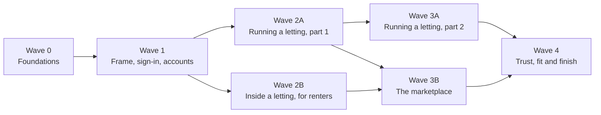

# 13. Work packages

Part of the [UX redesign PRD](README.md). This file splits the MVP into 28 packages in five waves. It is written for whoever builds a wave: a lead agent with one sub-agent per package, or a person.

The founder's own step-by-step guide is [BUILD.md](BUILD.md). This file is what a build session follows.

## The waves

A wave is one build session and one pull request. Waves with the same number (2A and 2B, 3A and 3B) can run at the same time in separate sessions.

| Wave | Packages | Starts when |
| --- | --- | --- |
| **0. Foundations** | WP-1 Funnel events and baselines · WP-2 Design system | Now |
| **1. Frame, sign-in and accounts** | WP-3 Shell and navigation · WP-4 Sign-in · WP-5 Accounts and first run · WP-6 The page frame for renters, owners and referees | Wave 0 is merged |
| **2A. Running a letting, part 1** | WP-7 Today and Lettings · WP-8 Inbox · WP-9 Adding a letting · WP-10 Reading an advert · WP-11 Forwarding enquiries | Wave 1 is merged |
| **2B. Inside a letting, for renters** | WP-12 The renter's pages · WP-13 Owner and referee pages · WP-14 Profile and the renter's home | Wave 1 is merged |
| **3A. Running a letting, part 2** | WP-15 A letting's page · WP-16 Calendar and viewings · WP-17 Decisions, checks and the offer · WP-18 Tenancy, close and settings · WP-19 Teams | Wave 2A is merged |
| **3B. The marketplace** | WP-20 Homes on Gaff · WP-21 Search · WP-22 Asking to view · WP-23 Saved homes and alerts | Waves 2A and 2B are merged |
| **4. Trust, fit and finish** | WP-24 A verified identity · WP-25 Fit · WP-26 Trust and Gaff's internal page · WP-27 Activation · WP-28 The end-to-end pass | Waves 3A and 3B are merged |

## How a wave is built

Follow these steps when asked to build a wave, or a single package.

1. **Read.** `CLAUDE.md`; this file; [section 1](01-users-and-principles.md) and [section 8](08-design-system-direction.md); and the sections each package in the wave lists under "Reads".
2. **Set up once.** Start Postgres and run the set-up commands in `CLAUDE.md`. Run `pnpm check` before changing anything. If it fails on a clean checkout, stop and say so.
3. **Check the wave can start.** The table above says what must be merged first. If it isn't, stop and say so.
4. **Build each package.** Use one sub-agent per package, each in its own worktree, when asked to. Give each sub-agent its package's brief, its "Reads" list and the rules below. Packages in a wave are listed in the order to merge them; a package that depends on another in the same wave says so.
5. **Tests that need the database or the web server run one at a time.** Worktrees share one Postgres and one port. Sub-agents run unit tests, the typecheck and lint in their own worktree. Integration and end-to-end tests are run by the lead, after each package is merged into the wave's branch.
6. **After each package:** merge it into the wave's branch; run `pnpm check`; fix what it finds; commit with the requirement IDs in the message.
7. **When every package is in:** run `pnpm check` and `pnpm build && pnpm test:e2e`. Update `docs/status.md`. Push.
8. **Open a pull request** into the repository's default branch when asked to. Title it "Wave N: …". In it: what each package built; the new screenshots from `screenshots/`; a short "Try this" list for the founder (from [BUILD.md](BUILD.md)); and anything left undone, with why.

### Rules for every package

1. `CLAUDE.md`'s product rules hold. If a requirement seems to break one, stop and say so. Never weaken a rule's test to get a pass.
2. Tests first, named by requirement ID: the PRD's ID where a requirement carries one (`R10: …`), otherwise this document's (`UX-NV-1: …`).
3. Every new screen gets a Playwright journey with an axe check, at 390px and 1280px wide, and a screenshot of each.
4. One design ([UX-DS-24 to 27](08-design-system-direction.md#one-design)): build each screen at phone width first. The same steps and words at every width.
5. Only the components in section 8. A missing component is added to `src/ui` and to section 8's table first.
6. Words renters see go in `src/copy/`. Fixed templates keep their wording.
7. No vendor needs a real account to build. Each new one sits behind an interface in `src/ports` with a local stand-in in `src/adapters`, as email, SMS and AI do. No vendor outside [section 11](11-compliance-and-vendors.md#vendors)'s table.
8. Build what the package says and no more. Something from a later wave is left as a clear, tested stub.
9. If the session needs a website the environment blocks (the PSRA's register, the RTB's), ask the founder to allow it and carry on with a made-up sample meanwhile. Tests and fixtures use made-up data only.
10. `pnpm check` and `pnpm test:e2e` pass. `docs/status.md` is updated.

## Briefs

"Reads" gives section numbers of this PRD.

### Wave 0. Foundations

**WP-1. Funnel events and baselines.** Reads 9.
- Requirements: UX-ME-1 to UX-ME-6.
- Deliver: an event for each step of each funnel in section 9, written by the use case that does the step, holding IDs, codes, numbers and dates only. A plain internal page showing each funnel. Baselines taken on the current product for the flows that exist.
- Done when: every existing flow's funnel shows a number, and the personal-data check on event payloads passes.

**WP-2. Design system.** Reads 8.
- Requirements: UX-DS-1 to UX-DS-29.
- Deliver: `docs/design-tokens.json` with role-named tokens, the new values and the rebuilt contrast list; `pnpm tokens` output; one type family; the wordmark as an image asset; and in `src/ui`: Button, Field, Choice card, Chips, Segmented progress, Sheet and dialog, Menu, Toast, Skeleton, Flow shell, date and time pickers, Code input, Avatar and badge. A component page under `/dev` showing each at both widths. `docs/design-system.md` rewritten.
- Not here: screens. The calendar, thread, photo uploader, address search, home card, gallery, search box and map belong to the packages that use them.
- Done when: the token tests pass in both themes; every component passes axe at 390px and 1280px; no control is a height other than 48px or has a target under 44px; existing screens still render.

### Wave 1. Frame, sign-in and accounts

**WP-3. Shell and navigation.** Reads 3, 4 (the flow rules).
- Requirements: UX-NV-1 to UX-NV-8, UX-NV-19 to UX-NV-21, UX-FL-1 to UX-FL-4.
- Deliver: the top bar and bottom tab bar for letting (Today, Lettings, Calendar, Inbox) and for renting (Search, Saved, Enquiries); the signed-out header; the account menu; the flow shell for focused tasks. Destinations that don't exist yet are empty states. The sidebar is removed.
- Done when: every existing workspace page renders in the new shell at both widths; the bar never wraps; it works by keyboard and screen reader.

**WP-4. Sign-in.** Reads 2.
- Requirements: UX-SI-1 to UX-SI-12.
- Deliver: the sign-in screen with Google, Apple and email; the six-digit code and its email; the same-device button; the passkey prompt and passkey sign-in; re-confirmation for the three sensitive actions. Google and Apple work against stand-ins locally and switch on with real credentials. A new ADR replacing ADR-0013's sign-in for people with accounts.
- Done when: a new and a returning user each sign in by code and by passkey in a journey; every state in the states table is covered; no tagline appears.

**WP-5. Accounts and first run.** Reads 2. Depends on WP-4.
- Requirements: UX-AC-1 to UX-AC-14, UX-AG-1 to UX-AG-7.
- Deliver: one profile per person on the existing organisation tables, with a silent organisation for a private landlord; first run with its three choices; the weekly copy of the PSRA register and its search; "being confirmed" and a simple confirm action for Gaff's team (the full internal page is WP-26); the weekly re-check; the context switcher. A new ADR for the account model.
- Done when: a renter reaches Search and a landlord reaches "Add your home" after one question; an agency user picks their agency without typing a licence; an unconfirmed agency can do everything except go live; row-level security tests still pass; no operator query can reach a person's profile.

**WP-6. The page frame for renters, owners and referees.** Reads 5 (Rules for every page).
- Requirements: UX-PP-1 to UX-PP-10, UX-AI-1, UX-AI-2, UX-AI-10.
- Deliver: the shared frame (header with the wordmark, the home block, the task, "what happens next", the footer); "Talk to a person"; the email layout with one button. Existing pages are moved into the frame unchanged in content.
- Done when: every existing renter, owner and referee journey passes inside the new frame.

### Wave 2A. Running a letting, part 1

**WP-7. Today and Lettings.** Reads 3.
- Requirements: UX-HM-1 to UX-HM-11, UX-NV-9 to UX-NV-12.
- Deliver: Today with its four blocks, the ordering rule, grouping and empty state; "Mine" and "Everyone" for admins; Lettings as a photo-led list.
- Done when: the ordering rule has unit tests (it extends `src/domain/dashboard/today.ts`); no row shows contact details.

**WP-8. Inbox.** Reads 3, 7.
- Requirements: UX-NV-13 to UX-NV-18, UX-AI-11, UX-AI-15.
- Deliver: the conversation list and thread; drafts in the reply box; one conversation for an email with an answerable and an unanswerable question; "Remember this"; the unmatched-email conversation with the confirmation code read out. Approvals, Questions and Needs attention are removed.
- Done when: the answers journeys (R8, R29) pass through Inbox; from Today, a draft is approved in two taps.

**WP-9. Adding a letting.** Reads 4, 6.
- Requirements: UX-LT-1, UX-LT-4, UX-LT-5, UX-LT-8 to UX-LT-16, UX-LT-22 to UX-LT-24.
- Deliver: the flow from "Fill it in myself" to go-live: address search behind an interface (manual fields as the stand-in), rent and date, the home, photo upload and hosting, letting details, the rent check one question per screen with its result, the go-live screen with "On gaff.ie" and the lister's phone number, "Is it advertised anywhere else?", "Let it again", "Send a test enquiry". The first screen exists, with reading left to WP-10.
- Not here: the public page itself (WP-20); the private landlord's identity check (WP-24, leave the step in place).
- Done when: a letting goes live from scratch in a journey; only what UX-LT-14 lists blocks go-live; errors appear only at fields; nothing is called "who it suits".

**WP-10. Reading an advert.** Reads 4, 7. Depends on WP-9.
- Requirements: UX-LT-1 to UX-LT-3, UX-LT-6, UX-LT-7, UX-AI-3 to UX-AI-5, UX-AI-8, UX-AI-9, UX-AI-12, UX-AI-13.
- Deliver: the reader behind the existing AI interface, with a stand-in for tests; "Here's what Gaff found" with sources on tap and "Check this" marks; the wording check on imported text and descriptions; starting a letting from an enquiry.
- Not here: fetching any link (Q31).
- Done when: tests on made-up adverts show no invented values, lines about who should apply left out with a reason, and instructions inside the text ignored; the manual route works with the reader switched off.

**WP-11. Forwarding enquiries.** Reads 4.
- Requirements: UX-LT-17 to UX-LT-20.
- Deliver: the four-screen flow; steps for Gmail, Outlook and "something else"; the confirmation-code reader; the test enquiry through the rule.
- Done when: a journey sets up forwarding and sees the test answered; a letting advertised elsewhere without forwarding shows it as its task.

### Wave 2B. Inside a letting, for renters

**WP-12. The renter's pages.** Reads 5 (Inside a letting), 6.
- Requirements: UX-RN-1 to UX-RN-26.
- Deliver: every page in the renter's path table: questions one per screen, answers sent, booking by day then time, booked, cancelled, a place offered, applying, checks one at a time, the offer, the agreement, paying, the PPS step, the inventory, and each outcome.
- Not here: keeping an identity check (WP-24); the fit lines (WP-25).
- Done when: the existing renter journeys pass on the new pages; no page has more than one primary button; nothing a renter reads is under 16px; only the four notices in UX-PP-6 remain.

**WP-13. Owner and referee pages.** Reads 5, 2 (Owners).
- Requirements: UX-OP-1 to UX-OP-9, UX-RF-1 to UX-RF-6, UX-OW-1, UX-OW-2, UX-OW-4.
- Deliver: the owner's one-screen page, the approval one person at a time, and the summary after the home is let; the reference form and its "Thanks"; "Share with the owner" in the letting's menu.
- Done when: the landlord and referee journeys pass; the owner's page shows no names before the offer stage and no internal events; the reference form has no free text.

**WP-14. Profile and the renter's home.** Reads 5 (The renter's home, Profile), 2 (Switching roles).
- Requirements: UX-RH-1 to UX-RH-6, UX-PF-1 to UX-PF-7.
- Deliver: Enquiries; Profile with its rows; "Keep my details for next time"; kept answers offered back for confirmation; attaching an enquiry when a signed-in renter opens a private link; download and delete; the two-year deletion in the retention job. Saved is an empty state for WP-23.
- Done when: a renter with a profile applies to a second home confirming, not retyping; deleting a profile removes it at once; integration tests show no operator can read a profile.

### Wave 3A. Running a letting, part 2

**WP-15. A letting's page.** Reads 4.
- Requirements: UX-LP-1 to UX-LP-13.
- Deliver: the header, four-part progress, Overview with its three blocks at each of the nine stages, People with its chips and person sheet, Home with editing, History. The old header, stage bar and tabs are removed.
- Done when: a journey walks one letting through all nine stages and checks the task at each; no fact appears twice; the page has the same three views at every stage.

**WP-16. Calendar and viewings.** Reads 4, 5 (Booking a viewing).
- Requirements: UX-VW-1 to UX-VW-11.
- Deliver: the calendar as a day list on a phone and a week on a desktop; Add a time; a viewing's sheet; suggested times; the calendar file; mark who came.
- Not here: calendar sync.
- Done when: the viewings and attendance journeys pass; the calendar has one primary action; everything works without dragging; all times are in Irish format.

**WP-17. Decisions, checks and the offer.** Reads 4.
- Requirements: UX-DC-1 to UX-DC-20.
- Deliver: Choose who views; Choose an applicant; the checks-are-back screen; Ask the owner; The offer. Each a focused flow ending in "Check and send". The old shortlist and applications pages are removed.
- Done when: the Slice 2 journeys pass; each decision is still a `PersonDecision` by a signed-in member; no page has three save buttons.

**WP-18. Tenancy, close and settings.** Reads 4, 12 (OQ-2).
- Requirements: UX-TN-1 to UX-TN-7, UX-ST-1 to UX-ST-3, UX-LP-14, UX-AI-14.
- Deliver: each tenancy step as a focused screen; where tenants pay, and a number to ring, asked at the payment step; the RTB screen; the inventory one item at a time; Finish and the results screen; Settings as rows. For comparable rents: first find out whether the RTB's Rent Register may be read by software and how; write the answer in `docs/open-questions.md`; build the lookup if it's allowed, and the pre-filled manual entry either way.
- Done when: the Slice 3 journeys pass; the RTB screen has copy buttons, a hidden PPS number and a way back; results show days and time saved.

**WP-19. Teams.** Reads 2.
- Requirements: UX-AG-8 to UX-AG-17.
- Deliver: roles and the permissions table enforced in `src/server`; a lead per letting; invites; removal with handover; leaving.
- Done when: integration tests cover each row of the permissions table; removing a member ends their access at once and leaves no letting without a lead.

### Wave 3B. The marketplace

**WP-20. Homes on Gaff.** Reads 5 (A home's page), 4 (Showing the home on Gaff).
- Requirements: UX-LT-21, UX-LS-1 to UX-LS-11.
- Deliver: a public page for each live letting that's switched on: gallery, title, action card, highlights, letting details, description, BER, the lister, "Report this listing" (the report itself lands in WP-26); the "has been let" state and removal after 30 days; sharing previews.
- Done when: a live letting's page opens signed out at both widths and passes axe; switching "On gaff.ie" off removes it; a private landlord shows by first name only; the page holds no personal data.

**WP-21. Search.** Reads 5 (The public site, Search), 6, 7.
- Requirements: UX-SR-1 to UX-SR-9, UX-SR-11, UX-SR-12, UX-MT-12 to UX-MT-15.
- Deliver: the public site's first screen; Gaff's own list of Irish places, built from OpenStreetMap; the search box that turns words into chips, with the filter sheet; results with "fits" first and "close" after; the empty state. Then the map, served from Gaff's own copy of OpenStreetMap; if that proves impractical, say why and ship the list alone (OQ-7).
- Done when: tests show a sentence becomes only the allowed fields and anything else is dropped and not stored; search works signed out and with the reader switched off; no search leaves Gaff.

**WP-22. Asking to view.** Reads 5 (Asking to view). Depends on WP-20.
- Requirements: UX-AV-1 to UX-AV-9.
- Deliver: the flow from a home's page; two taps for a renter with a profile; the email confirmation for a typed address; the first reply; the enquiry arriving in the letting with its source; merging with a Daft enquiry from the same person.
- Done when: a journey finds a home on Gaff, asks to view with no account, confirms by email and appears in the operator's People; the same with a profile takes two taps; nothing beyond a name, an email and the answers is collected.

**WP-23. Saved homes and alerts.** Reads 5 (Search, The renter's home).
- Requirements: UX-SR-10, and Saved in the renter's home.
- Deliver: saving a home; saving a search with just an email; the alert email, at most one a day, with "Stop these"; Saved.
- Done when: a journey saves a search, a matching home goes live, and the alert arrives once.

### Wave 4. Trust, fit and finish

**WP-24. A verified identity.** Reads 5 (A verified identity, Trust and safety).
- Requirements: UX-PF-8 to UX-PF-14, UX-TS-1, UX-TS-2.
- Deliver: "Keep this" after a passed check; reuse at the next checks with the renter's yes; reuse across roles; "Confirm it's you" for a private landlord at their first go-live; "Identity verified" on their homes; redo from Profile. Only the result, the name and the date are stored.
- Done when: compliance tests show nothing else is stored, no operator can see who's verified before choosing, and no renter is prompted before being chosen; a private landlord can't go live unverified.

**WP-25. Fit.** Reads 6, 4 (People).
- Requirements: UX-MT-1 to UX-MT-11, UX-MT-16 to UX-MT-18, UX-LP-15, UX-AI-6, UX-AI-7.
- Deliver: the Letting details line generated from the criteria; fit beside a renter's answers and on a home's page; "Meets n of n" everywhere fit is shown; the pool summary; lawful alternatives for unlawful wording; "Ask about who's enquired".
- Done when: compliance tests show the line can't be edited, ranking is unchanged, nobody is removed for not fitting, the pool summary names no person, and a question about anything but the four answers is declined without naming anyone.

**WP-26. Trust and Gaff's internal page.** Reads 5 (Trust and safety), 2 (Confirming an agency).
- Requirements: UX-TS-3 to UX-TS-6, UX-AG-4.
- Deliver: the report flow; Gaff's internal page with its three lists (agencies to confirm, reported listings, the funnels from WP-1); hiding a listing and telling its lister. Access for named Gaff staff only.
- Done when: a report reaches the page and hiding a listing removes it from search and pauses its enquiries; tests show the page can't open a letting, send a message or make a decision.

**WP-27. Activation.** Reads 9.
- Requirements: UX-GR-1 to UX-GR-9.
- Deliver: the setup checklist for each kind of user; the prompts in section 9's table with their rules; the wordmark and "Run with Gaff" placements.
- Done when: a new agency admin's journey completes the checklist; no screen shows two prompts; no prompt blocks a task.

**WP-28. The end-to-end pass.** Reads all.
- Deliver: two journeys that cross both sides: an agency's home found on Gaff and let to a renter with no account; a private landlord's home let to a renter with a profile and a kept identity. A sweep of every screen against the principles' tests in section 1: one primary action, no line that isn't needed, 390px first. `docs/prd.md`, `docs/architecture.md`, `docs/design-system.md` and `docs/launch-checklist.md` brought up to date.
- Done when: both journeys pass with axe on every page, and `docs/status.md` says the MVP is built.
